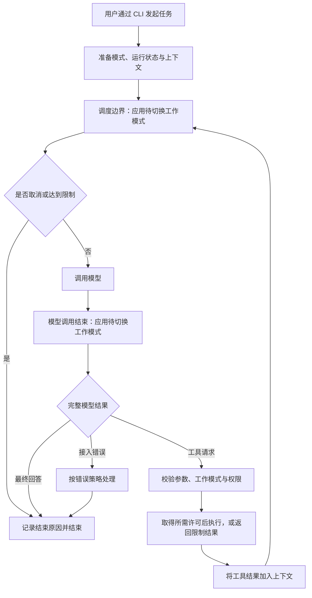

# 架构设计

**0.1.0 已完成 P0 至 P7 验收并发布。本文描述已交付架构，后续应用分层与扩展方案见[后续开发计划](post-mvp-plan.md)。**

约束为 Rust、CLI → TUI → GUI、Saya 自己驱动 Agent 循环，同时支持编程与通用任务。CLI 包含交互和单次运行、四种工作模式、三种权限模式、三类模型协议、本地工具、流式／结构化输出和会话恢复，默认 WORK 与 auto。精确契约以[完整基线](mvp-baseline.md)为准，范围见[需求规格](requirements.md)，行为见[执行契约](execution.md)。

## 职责边界

| 部分 | 职责 |
| --- | --- |
| 界面层 | 处理交互与单次命令、流式与结构化输出，展示当前／待切换工作模式和权限模式，传递切换、确认与取消操作 |
| 运行时 | 驱动 Agent 循环，在调用边界应用工作模式切换，协调权限、模型、工具、状态和终止条件 |
| 模型适配 | 将内部请求与模型协议转换，返回回答、工具请求或接入错误 |
| 工具执行 | 根据工具声明校验参数、执行操作并返回结构化结果 |
| 权限处理 | 实现 auto、bypass permissions 与Manual Approval；协调规则判断、必要的模型核查与用户确认 |
| 上下文管理 | 组织模型所需的消息、工具声明与历史结果 |
| 会话存储 | XDG 数据目录中的 SQLite WAL、状态事务保存、写锁、版本迁移与恢复 |

0.1.0 Cargo workspace 包含 saya-core 与 saya-cli，二进制为 saya。CLI 负责终端、命令参数、运行组装与输出呈现，core 提供复用运行时。Rust 1.99.1／edition 2024、依赖职责与平台基线见 B-02。

DEV-038 已建立 saya-app，负责模型组装、会话创建／恢复和锁生命周期，CLI 使用同一服务。模型装饰通过调用者提供的适配器接入。DEV-039 的有界事件及人工输入桥由 saya-app 提供，CLI 负责 stdout 与终端呈现，取消句柄与 RuntimeHandle 连接运行控制。TUI 拟采用 saya-tui library，由 saya-cli 统一路由。具体依赖、控制与事件边界见[TUI 设计](tui.md)，实现范围按 DEV-038 至 DEV-053 验证。

执行层拟通过 ExecutionBackend 连接独立 SeatbeltBackend 及 Linux Bubblewrap／Seccomp／socat 组合，预留容器／VM 的实现路径，实际能力分级见[原生隔离设计](sandbox.md)。BrowserProvider、ContextBuilder／OutputStore 与插件规范分别见[Browser](browser.md)、[上下文](context-management.md)和[saya-plugin](saya-plugin.md)。

运行时通过输入、控制与事件／结果接口连接界面。终端格式、TUI 组件和 GUI 状态管理不进入核心循环；结果与事件使用 B-17 的 schema v1。内部 Rust 函数签名按实现处理，0.1 不承诺独立 SDK 稳定性。

## 运行模式

四种模式及已确认的职责见[运行模式](modes.md)。PLAN 只读调查并输出需求分析与规划，不修改工作区文件；BUILD 负责端到端实现和交付；CODE 聚焦代码编写、修改与调试；WORK 负责通用任务执行。

工作模式与权限模式分别传入运行时，供各界面复用。PLAN 在三种权限模式下均只读且禁用通用 exec，由工具调度边界落实；其他操作按权限模式处理。

工作模式由用户手动切换，Agent 可建议但不自行切换；当前调用完成后、下一次调用前生效，保留上下文。显式区分当前与待切换模式，重查未执行工具；连续请求最后一次优先，取消优先。默认前台工具串行，显式运行内后台工具可并发；切入 PLAN 前取消并清理后台写入和命令，权限模式仅空闲时修改。

auto 的 TOML 规则按 deny＞ask＞allow 判断，原生工作区读写默认 allow，未匹配 exec 进入独立核查，默认复用执行 profile，最后由用户兜底。Manual Approval 对每次工具调用进行人工确认，包括读取、搜索与后台控制，模型请求不单独确认；bypass 跳过路径、人工和模型核查，但保留 PLAN、显式 deny 与其他硬限制。确认绑定单个操作与版本，不持久化授权。精确规则见 B-09 至 B-11。

## 模型、工具与存储

三类模型协议分别实现文本流、工具与错误适配，不共用某一家请求 DTO 驱动核心。core 使用统一内部消息并保留必要协议状态、调用标识与不透明内容；映射及版本按 B-05、B-06 分别验证。不启用 provider 服务端工具、provider 侧后台任务或自动协议回退；本地后台任务由 Saya 管理。

八个工具及结果按 B-14 实现。参数完整并校验后，检查工作模式、允许路径、显式规则及所需核查／确认，在实际派发前重查。bypass 跳过路径范围检查但不跳过 PLAN。文件修改使用版本冲突检查与单文件替换，命令使用 argv，不提供操作系统沙箱。

run 默认不交互，显式预授权精确匹配本次运行；无法询问且缺少许可返回 needs_confirmation／3，缺少澄清返回 needs_input／4。确认与澄清由界面承接，许可由 core 协调；stdout 的 JSON／JSONL 与 stderr 诊断、控制终端提示分离。

会话使用 SQLite WAL，内部数据库 schema 为 2，保存完整消息、必要协议状态、工具意图／结果与关键业务事件。副作用前保存意图，调用后保存结果；失败停止后续调度。恢复原历史、工作模式与配置引用后等待输入，不重执行工具，权限使用本次启动设置，不恢复历史授权。

数据与日志使用 B-18 的 XDG 目录，PLAN 下不能与目标工作区重叠。每会话跨进程排他写锁；迁移先备份，unknown 不自动重执行，配置与工作区变化按 B-20 显式处理。SQLite 操作不能阻塞模型流与控制事件的处理。

## 执行流程

图中为主流程，许可检查包含规则、必要核查与确认。默认前台工具按返回顺序串行；显式后台启动返回任务 ID，模型可继续调用并查询结果，每次派发重查模式；工具错误作为结果返回，框架不自动重跑。非交互结束、有限模型重试和连续失败限制按 B-11、B-16 执行，流式参数完整前不派发。

## 运行状态与结束原因

运行状态区分以下概念：

- **运行实例**：一次任务执行的状态与资源边界。
- **当前／待切换工作模式**：区分已经生效与等待当前调用完成的用户选择。
- **权限模式与许可**：区分本次启动权限设置、具体工具的判断结果与人工确认；历史授权不在恢复时重新生效。
- **对话上下文**：本次模型交互所需的输入、历史消息和工具结果。
- **结束原因**：completed、failed、cancelled、limit_reached、needs_confirmation、needs_input；退出码见 B-17。
- **运行事件**：供界面展示的模型调用、工具执行和结束等状态变化。

会话与运行使用 UUIDv7。工具状态区分待执行、待确认、执行中、成功、失败、拒绝及 unknown；悬空调用以对应终止结果闭合协议记录，不重新执行。会话／运行边界见[需求规格](requirements.md)，持久化细节见 B-18 至 B-20。

## 错误与终止

错误按来源区分，保留调用关联和可定位原因：

- 配置错误：模型配置缺失、输入无效等，在执行前尽量检查。
- 模型错误：连接、协议、响应解析等失败，向上层返回明确原因。
- 工具错误：未知工具、参数无效、执行失败或超时，保留与对应调用的关联。
- 运行终止：取消或达到限制，避免继续发起新的模型与工具调用。

每次运行默认 64 次模型请求、256 次工具调用、1800 秒活跃时间，人工等待暂停计时。模型连接／流空闲／总超时为 10／60／180 秒，命令默认 120 秒；配置可调整。模型重试最多 2 次且仅在未接收成功响应内容前，工具不自动重跑。取消覆盖等待中的模型与工具，进程组清理 5 秒后强制结束。

## 工程与验证边界

所有产品与接口阻塞项已由[完整基线](mvp-baseline.md) B-01 至 B-24 收敛；具体内部 Rust 类型和模块文件名由开发者在保持行为的前提下处理。Tokio、clap、reqwest＋rustls、serde／toml、thiserror、tracing 与 rusqlite 的职责按 B-02 实现。

core／CLI crate 和锁文件已建立，普通构建提供可复用运行时、七项本地工具、权限调度、后台任务和三协议适配。模型协议、profile 核查、恢复和事件输出通过受控验证，指定模型完成三协议小规模联调。正式源码的四原生平台分别通过 342 项 Rust 测试和解包演练，公开发行包完成下载复核。具体环境与证据见[发行验证](release-validation.md)和[开发进度](progress.md)。

## 提示词装配

核心、四工作模式、三权限说明、条件后台段和独立核查的实际代码及来源取舍见[提示词定制](prompts.md)。运行时 prompt 用英文，用户沟通不固定为某种语言。工作模式与权限由类型化运行状态选择，来源文本不作为系统指令。当前装配器、项目指令和三协议均已接入可复用 core 循环及 CLI；独立审核请求使用单独提示词。
