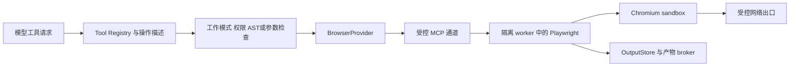

# Browser 能力设计

**更新于 2026-11-12。浏览器能力归 F-10，DEV-079 至 DEV-082 负责接口、worker、策略与界面集成，DEV-083 负责联合验收。DEV-079 已实现宿主接口、受控网页读取与离线测试；DEV-080 至 DEV-083 仍未开始，本文其余部分保持设计草案。**

## DEV-079 实现状态

DEV-079 只交付宿主侧组件，不包含真实 Chromium 或 Playwright worker，也不声称浏览器会话已经可用。

- `saya-core::browser` 提供 `BrowserProvider` 与 `BrowserState`。每个 Run 拥有私有会话；同一页面动作串行；页面、文档和元素引用使用随机不透明 token，宿主保留元素映射。`snapshot` 创建新文档并使旧引用失效；`navigate` 是建立新文档的动作，只返回 `page`／`url`（旧 document 引用因此失效，不要求 document token）；`click`、`fill`、`press`、`upload` 要求显式当前 `document` token 并核验，`wait` 后保守作废文档；这些动作结果返回 `document_revision`。未知结果绑定到发生动作的具体页面：只有该页面自身的新 snapshot 或完整 close 才能恢复；其他页面 snapshot 或新 open 不会清除它。`open` 自身 unknown 使用独立全局保守状态阻断所有旧页面，只有完整 close／shutdown 可清。已派发的动作被取消时按 `outcome_unknown` 处理并持久化为 unknown；入口即已取消则返回 `cancelled`。`browser_close` 在 provider 确认前不丢弃 session／pages，已知失败可安全重试；shutdown 幂等但失败可重试，且完整 shutdown 后的 open 失败或取消不会复用旧的干净状态。`FixtureProvider` 提供无网络的可控状态、并发、取消、unknown、close 失败、provider 截断与慢 shutdown 测试。
- `saya-core::web` 提供受控 `fetch_url` 与仅在显式 endpoint 配置时注册的 `web_search`。仅允许 HTTP／HTTPS GET／HEAD，拒绝 userinfo、fragment、特殊 scheme 和系统 proxy；每次重定向重新执行 origin、公开地址与完整 DNS 答案检查，并把连接固定到已核查 IP。DNS 解析与响应体读取同时受 timeout 与取消约束；响应大小、内容类型、UTF-8、超时和取消均有边界。字节截断落在 UTF-8 多字节中间时保留有效前缀并标记 truncated，真正损坏的输入仍返回 `invalid_utf8`。HTML 正文通过已锁定的 `lol_html 3.0.3` 做有界流式提取，除 `RawText`／`ScriptData` 外还以 element handler 移除任意命名空间的 script／style／noscript／template（覆盖 SVG／MathML），并在相邻文本块之间保留空白分隔。所有网页内容标记为 `untrusted_web`。
- 模型工具面固定为 `fetch_url`、`web_search` 及 `browser_open`／`close`／`navigate`／`snapshot`／`click`／`fill`／`press`／`wait`／`screenshot`／`download`／`upload`。不注册 selector、任意脚本、evaluate、install、devtools 或原始 MCP 工具。截图、下载和上传仅在 provider facts 声明支持时注册；DEV-079 只返回经校验的元数据，不保存未 pin 的截图媒体，真实媒体保存与注入由 DEV-082 完成。provider 返回的 URL／title／detail／filename／mime 等来源字段有明确长度与控制字符上限，非法值返回 `invalid_provider_result`，不截断后冒充最终来源。download／upload 结果同样带 `source = untrusted_browser`。
- registry 新增 `WebRead`、`BrowserRead`、`BrowserWrite`。`browser_open`／`close`／`navigate` 为 `BrowserWrite`；`browser_snapshot`／`wait`／`screenshot` 为 `BrowserRead`；`click`／`fill`／`press`／`download`／`upload` 为 `BrowserWrite`。PLAN 只开放 `WebRead`，两类 Browser 效果均拒绝；已保存观察继续通过 `output_read`／`output_search` 检索。`auto` 允许 `WebRead`／`BrowserRead`，`BrowserWrite` 走现有独立模型核查；Manual Approval 逐次确认；bypass 仍受 PLAN 与显式 deny 限制。只读运行时既不注册也不执行 Browser 工具。宿主 built-in adapter 通过有界 schema 校验进入既有注册、审批指纹、捕获与持久化路径。
- OutputStore 新增 `Web`／`Browser` 流。长正文和页面快照经 `capture → save_result_with_outputs → publish` 保存，保留 `output_ref`、coverage 与 truncated 信息。快照捕获包含宿主投影后的 text／elements／document／source 等字段，捕获上限使用 `BrowserSettings.max_snapshot_bytes`；provider、宿主提取、inline 或捕获任一不完整均以 `CaptureCompletion::LimitReached` 记录，`truncated` 一致反映到 `data`、`ToolResult` 与 output metadata。检索到对象但 `retained_bytes = 0`、withheld 或 capture disabled 时，`fetch_url` 与 `browser_snapshot` 回退有界 inline 内容并标记 truncated，不返回空成功。`web_search` 的长结果投影只保留 `result_count` 等元数据，正文经 `output_read`／`output_search` 回取。
- `AgentRuntime::with_web`／`with_browser` 注册入口已存在。`RuntimeServices` 持有浏览器状态，并在既有 PLAN 清理与 Run shutdown 中先于 environment 与 broker 清理以有界超时调用 provider shutdown；browser 清理失败不会跳过 MCP、插件、environment、broker 与目录清理，首个错误在末尾汇总。清理保留可重启状态，返回 WORK 后显式 `browser_open` 会创建全新 provider 生命周期。`WebSettings`／`BrowserSettings` 默认关闭，配置加载复用 broker policy 执行严格校验；搜索 endpoint 必须严格规范化 HTTP／HTTPS，并拒绝字面私网／回环地址（显式 localhost 开发 origin 除外）；开发 origin 必须是回环地址，回环 allowlist 条目必须同时指定为开发 origin。
- 生产装配：`saya-app` 仅接入显式启用的 web；`browser.enabled` 在 DEV-080 worker 之前返回明确错误，不伪造可用浏览器。真实 Chromium sandbox、Playwright、登录、文件 broker、模型图片与跨平台验收仍属后续任务。

## 范围与首个实现

浏览器能力包含 URL 读取、网页观察与交互、截图、下载以及本地网页验证。首版候选为宿主管理的临时 Chromium 会话，通过受控 Playwright MCP worker 接入。Rust core 负责工具、权限、生命周期和预算，Playwright 运行在可选隔离环境中。

| 增量 | 内容 |
| --- | --- |
| B0 受限网页读取 | 显式 URL／已配置搜索服务、正文提取、来源、重定向校验及长输出引用 |
| B1 托管浏览器 | 创建／关闭、导航、ARIA 快照、定位、点击、填写、按键、截图与等待 |
| B2 受控会话资源 | 下载／上传、授权登录、有限 profile 保存与本地开发服务 |
| 后续连接方式 | 用户现有浏览器、远程浏览器或其他引擎，分别验证权限与生命周期 |

Playwright MCP 提供基于结构化 accessibility snapshot 的工具接口。工具清单由 Saya 的注册与策略层筛选，特定 provider 的完整工具集合在兼容测试中记录。[Playwright MCP](https://github.com/microsoft/playwright-mcp)

## 宿主与 worker 边界

BrowserProvider 管理会话 ID、页面 ID、文档版本、能力、任务归属和清理。每个 Run 默认获得私有临时会话，同一页面的动作串行执行。调用通过稳定的内部操作类型映射到经验证的 MCP 工具名。

浏览器控制使用受管理通道，控制端点和认证引用由宿主持有。模型接收页面／元素引用与操作结果。扩展工具、任意脚本执行、浏览器安装及通用代码入口按独立能力注册和验证。

## 工具与权限草案

| 模型工具族 | 参数与返回 | 策略类别 |
| --- | --- | --- |
| `fetch_url`／`web_search` | URL 或查询、正文／摘要、来源与 output_ref | 受限网络读取，搜索使用显式配置的服务 |
| `browser_open`／`browser_close` | 会话、页面、归属及状态 | 浏览器资源生命周期 |
| `browser_navigate` | URL、最终来源；建立新文档并返回 page／url | 浏览器交互与网络 |
| `browser_snapshot` | 页面、子树／查询、元素引用、水位 | 页面观察 |
| `browser_click`／`browser_fill`／`browser_press` | 当前文档元素引用、动作与结果 | 可能的外部副作用 |
| `browser_wait` | 有界条件、时间及状态 | 有界等待 |
| `browser_screenshot` | 范围、遮蔽、图片产物 ID | 图像产物访问 |
| `browser_download`／`browser_upload` | 已授权产物引用、来源及摘要 | 文件传输 |

首版 PLAN 工具面限定为受限 URL 读取及已保存观察结果，主动浏览器交互在 BUILD／CODE／WORK 中按策略执行。URL 读取使用受控 GET／HEAD 和目标范围，记录实际网络行为。服务端 GET 的真实效果依赖目标服务语义。

`auto` 根据宿主分类、规则和必要核查决定交互许可。`manual` 包括快照和后台查询在内逐工具批准。提交、上传、下载和凭据使用具有独立操作描述。`bypass` 受选定浏览器 profile 的实际隔离与网络边界约束。

元素引用绑定 page／document revision；`navigate` 建立新文档，`click`／`fill`／`press`／`upload` 使用当前文档，页面导航或关键结构变化后重新取得引用。确认绑定来源、页面版本、参数与策略版本，执行前重查。

## 隔离与网络

浏览器 worker 通过 SeatbeltBackend 或 BubblewrapBackend 启动，使用独立临时目录及受控产物交换范围。Linux 使用 Bubblewrap + Seccomp + socat，Chromium 以普通用户运行，单独验证允许其自有 sandbox 所需的 syscall。macOS 验证外层 Seatbelt 与 Chromium 子进程限制的组合。Playwright／Chromium 版本和运行文件身份固定，启动时验证实际 sandbox 能力。[原生执行设计](sandbox.md)

适配器显式设置 `chromiumSandbox = true`，并验证所选 worker 的实际启动状态。Playwright 的该启动选项默认关闭。[BrowserType 启动选项](https://playwright.dev/docs/api/class-browsertype#browser-type-launch-option-chromium-sandbox)

Playwright BrowserContext 提供 cookies 和存储层的会话隔离，原生执行后端负责宿主资源边界。[Browser contexts](https://playwright.dev/docs/browser-contexts)

URL 读取使用独立的受控 HTTP 客户端，认证信息按用途绑定。网络经受控代理和实际出口限制，逐连接检查最终地址、重定向、内网／元数据地址和 DNS 变化。首版关闭 service workers，WebSocket、直连 UDP／QUIC、代理旁路及浏览器特殊 URL 按明确能力处理。允许的导航 scheme 为 HTTP／HTTPS，内部空白页由宿主创建。

本地开发服务采用用户显式绑定的目标转发，记录主机、端口和生命周期。provider 的 origins／hosts 选项作为辅助配置，出口约束由 Saya 的执行环境和代理承担。Playwright MCP 文档说明其 origins 过滤具有适用边界。[MCP 配置与安全说明](https://github.com/microsoft/playwright-mcp#security)

## 登录、文件与输出

- 临时 profile 按 Run 清理。登录状态保存或复用需要单独范围、来源和期限，用户级凭据由 F-18 管理。
- 认证字段使用绑定 origin 的 credential slot，实际值通过宿主 broker 注入。工具意图、日志和上下文保存引用与遮蔽后的信息。
- 上传使用已授权 artifact ID，下载经 broker 生成文件名、检查来源／大小／类型并保存摘要。写入项目文件时经过工作区写回策略。
- 默认观察使用有界 ARIA／文本快照，返回子树、匹配项与文档水位。完整可保留内容按[输出策略](context-management.md)进入 OutputStore。
- 截图作为有界图片产物保存，文字结果返回元数据。图片注入依据模型 profile 的实际多模态能力，敏感输入遮蔽在截图生成前执行。
- 长导航、等待及下载可按 provider 声明显式后台运行，返回 job ID。后续依赖动作等待已完成状态，取消与 Run 结束清理由宿主协调。

## 交互与恢复

CLI／TUI 展示最终 URL、来源、页面／文档版本、当前动作、确认原因、后台状态和产物。网页文本、下载内容、脚本和插件说明以低信任来源数据进入模型上下文。

Run 结束或取消时停止调度并清理浏览器、worker、临时 profile 和下载任务。恢复保留观察与产物记录，重新建立的浏览器会话具有新身份。提交类动作的未知结果等待核对，后续操作使用新的显式调用。

## 验收

离线夹具提供静态页、动态 DOM、重定向、本地服务、表单、下载和长页面。覆盖陈旧元素引用、隐藏跳转、service worker／WebSocket 尝试、内部地址、特殊 URL、文件路径、输出配额、密码遮蔽、浏览器崩溃、取消、后台清理和 unknown 提交结果。

报告按平台记录实际浏览器 sandbox、网络策略、原生后端及资源能力。任务依赖及版本安排见[后续开发计划](post-mvp-plan.md)。
