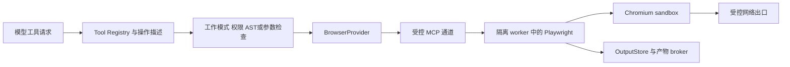

# Browser 能力设计

**更新于 2026-11-08。浏览器能力归 F-10，DEV-079 至 DEV-082 负责接口、worker、策略与界面集成，DEV-083 负责联合验收。本文为后续设计草案。**

## 范围与首个实现

浏览器能力包含 URL 读取、网页观察与交互、截图、下载以及本地网页验证。首版候选为宿主管理的临时 Chromium 会话，通过受控 Playwright MCP worker 接入。Rust core 负责工具、权限、生命周期和预算，Playwright 运行在可选隔离环境中。

| 增量 | 内容 |
| --- | --- |
| B0 受限网页读取 | 显式 URL／已配置搜索服务、正文提取、来源、重定向校验及长输出引用 |
| B1 托管浏览器 | 创建／关闭、导航、ARIA 快照、定位、点击、填写、按键、截图与等待 |
| B2 受控会话资源 | 下载／上传、授权登录、有限 profile 保存与本地开发服务 |
| 后续连接方式 | 用户现有浏览器、远程浏览器或其他引擎，分别验证权限与生命周期 |

Playwright MCP 提供基于结构化 accessibility snapshot 的工具接口。工具清单由 Saya 的注册与策略层筛选，特定 provider 的完整工具集合在兼容测试中记录。[Playwright MCP](https://github.com/microsoft/playwright-mcp)

## 宿主与 worker 边界

BrowserProvider 管理会话 ID、页面 ID、文档版本、能力、任务归属和清理。每个 Run 默认获得私有临时会话，同一页面的动作串行执行。调用通过稳定的内部操作类型映射到经验证的 MCP 工具名。

浏览器控制使用受管理通道，控制端点和认证引用由宿主持有。模型接收页面／元素引用与操作结果。扩展工具、任意脚本执行、浏览器安装及通用代码入口按独立能力注册和验证。

## 工具与权限草案

| 模型工具族 | 参数与返回 | 策略类别 |
| --- | --- | --- |
| `fetch_url`／`web_search` | URL 或查询、正文／摘要、来源与 output_ref | 受限网络读取，搜索使用显式配置的服务 |
| `browser_open`／`browser_close` | 会话、页面、归属及状态 | 浏览器资源生命周期 |
| `browser_navigate` | URL、等待条件、最终来源、文档版本 | 浏览器交互与网络 |
| `browser_snapshot` | 页面、子树／查询、元素引用、水位 | 页面观察 |
| `browser_click`／`browser_fill`／`browser_press` | 当前文档元素引用、动作与结果 | 可能的外部副作用 |
| `browser_wait` | 有界条件、时间及状态 | 有界等待 |
| `browser_screenshot` | 范围、遮蔽、图片产物 ID | 图像产物访问 |
| `browser_download`／`browser_upload` | 已授权产物引用、来源及摘要 | 文件传输 |

首版 PLAN 工具面限定为受限 URL 读取及已保存观察结果，主动浏览器交互在 BUILD／CODE／WORK 中按策略执行。URL 读取使用受控 GET／HEAD 和目标范围，记录实际网络行为。服务端 GET 的真实效果依赖目标服务语义。

`auto` 根据宿主分类、规则和必要核查决定交互许可。`manual` 包括快照和后台查询在内逐工具批准。提交、上传、下载和凭据使用具有独立操作描述。`bypass` 受选定浏览器 profile 的实际隔离与网络边界约束。

元素引用绑定 browser／page／document revision，页面导航或关键结构变化后重新取得引用。确认绑定来源、页面版本、参数与策略版本，执行前重查。

## 隔离与网络

浏览器 worker 通过 SeatbeltBackend 或 BubblewrapBackend 启动，使用独立临时目录及受控产物交换范围。Linux 使用 Bubblewrap + Seccomp + socat，Chromium 以普通用户运行，单独验证允许其自有 sandbox 所需的 syscall。macOS 验证外层 Seatbelt 与 Chromium 子进程限制的组合。Playwright／Chromium 版本和运行文件身份固定，启动时验证实际 sandbox 能力。[原生执行设计](sandbox.md)

适配器显式设置 `chromiumSandbox = true`，并验证所选 worker 的实际启动状态。Playwright 的该启动选项默认关闭。[BrowserType 启动选项](https://playwright.dev/docs/api/class-browsertype#browser-type-launch-option-chromium-sandbox)

Playwright BrowserContext 提供 cookies 和存储层的会话隔离，原生执行后端负责宿主资源边界。[Browser contexts](https://playwright.dev/docs/browser-contexts)

URL 读取使用独立的受控 HTTP 客户端，认证信息按用途绑定。网络经受控代理和实际出口限制，逐连接检查最终地址、重定向、内网／元数据地址和 DNS 变化。首版关闭 service workers，WebSocket、直连 UDP／QUIC、代理旁路及浏览器特殊 URL 按明确能力处理。允许的导航 scheme 为 HTTP／HTTPS，内部空白页由宿主创建。

本地开发服务采用用户显式绑定的目标转发，记录主机、端口和生命周期。provider 的 origins／hosts 选项作为辅助配置，出口约束由 Saya 的执行环境和代理承担。Playwright MCP 文档说明其 origins 过滤具有适用边界。[MCP 配置与安全说明](https://github.com/microsoft/playwright-mcp#security)

## 登录、文件与输出

- 临时 profile 按 Run 清理。登录状态保存或复用需要单独范围、来源和期限，用户级凭据由 F-18 管理。
- 认证字段使用绑定 origin 的 credential slot，实际值通过宿主 broker 注入。工具意图、日志和上下文保存引用与遮蔽后的信息。
- 上传使用已授权 artifact ID，下载经 broker 生成文件名、检查来源／大小／类型并保存摘要。写入项目文件时经过工作区写回策略。
- 默认观察使用有界 ARIA／文本快照，返回子树、匹配项与文档水位。完整可保留内容按[输出策略](context-management.md)进入 OutputStore。
- 截图作为有界图片产物保存，文字结果返回元数据。图片注入依据模型 profile 的实际多模态能力，敏感输入遮蔽在截图生成前执行。
- 长导航、等待及下载可按 provider 声明显式后台运行，返回 job ID。后续依赖动作等待已完成状态，取消与 Run 结束清理由宿主协调。

## 交互与恢复

CLI／TUI 展示最终 URL、来源、页面／文档版本、当前动作、确认原因、后台状态和产物。网页文本、下载内容、脚本和插件说明以低信任来源数据进入模型上下文。

Run 结束或取消时停止调度并清理浏览器、worker、临时 profile 和下载任务。恢复保留观察与产物记录，重新建立的浏览器会话具有新身份。提交类动作的未知结果等待核对，后续操作使用新的显式调用。

## 验收

离线夹具提供静态页、动态 DOM、重定向、本地服务、表单、下载和长页面。覆盖陈旧元素引用、隐藏跳转、service worker／WebSocket 尝试、内部地址、特殊 URL、文件路径、输出配额、密码遮蔽、浏览器崩溃、取消、后台清理和 unknown 提交结果。

报告按平台记录实际浏览器 sandbox、网络策略、原生后端及资源能力。任务依赖及版本安排见[后续开发计划](post-mvp-plan.md)。
