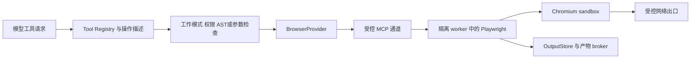

# Browser 能力设计

**更新于 2026-11-13。浏览器能力归 F-10，DEV-079 至 DEV-082 负责接口、worker、策略与界面集成，DEV-083 负责联合验收。DEV-079 已实现宿主接口、受控网页读取与离线测试。DEV-080 的组件已完成 Playwright MCP 启动、身份校验、固定工具映射与生命周期，并按 D-066 增加显式专用 VM 后端；该后端的真实入口已在专用 Colima VM 上实际执行并通过（renderer 的 NoNewPrivs／Seccomp 与合法 sandbox argv、远端 Run 根和进程清理）。native worker 的组件测试通过，但 macOS Seatbelt 与 Linux Bubblewrap 当前都不能完成 Chromium 内层 sandbox 初始化，因此 native 浏览器未取得真实平台验收，也不得视为可用。DEV-081A 的 Browser 网络阶段已完成并取得专用 VM 真实网络验收；DEV-081 的登录、文件 broker、截图与后台阶段，以及 DEV-082、DEV-083 仍未开始，N5 尚未完成，四平台验收尚未执行，本文其余部分保持设计草案。**

## DEV-079 实现状态

DEV-079 只交付宿主侧组件，不包含真实 Chromium 或 Playwright worker，也不声称浏览器会话已经可用。

- `saya-core::browser` 提供 `BrowserProvider` 与 `BrowserState`。每个 Run 拥有私有会话；同一页面动作串行；页面、文档和元素引用使用随机不透明 token，宿主保留元素映射。`snapshot` 创建新文档并使旧引用失效；`navigate` 是建立新文档的动作，只返回 `page`／`url`（旧 document 引用因此失效，不要求 document token）；`click`、`fill`、`press`、`upload` 要求显式当前 `document` token 并核验，`wait` 后保守作废文档；这些动作结果返回 `document_revision`。未知结果绑定到发生动作的具体页面：只有该页面自身的新 snapshot 或完整 close 才能恢复；其他页面 snapshot 或新 open 不会清除它。`open` 自身 unknown 使用独立全局保守状态阻断所有旧页面，只有完整 close／shutdown 可清。已派发的动作被取消时按 `outcome_unknown` 处理并持久化为 unknown；入口即已取消则返回 `cancelled`。`browser_close` 在 provider 确认前不丢弃 session／pages，已知失败可安全重试；shutdown 幂等但失败可重试，且完整 shutdown 后的 open 失败或取消不会复用旧的干净状态。`FixtureProvider` 提供无网络的可控状态、并发、取消、unknown、close 失败、provider 截断与慢 shutdown 测试。
- `saya-core::web` 提供受控 `fetch_url` 与仅在显式 endpoint 配置时注册的 `web_search`。仅允许 HTTP／HTTPS GET／HEAD，拒绝 userinfo、fragment、特殊 scheme 和系统 proxy；每次重定向重新执行 origin、公开地址与完整 DNS 答案检查，并把连接固定到已核查 IP。DNS 解析与响应体读取同时受 timeout 与取消约束；响应大小、内容类型、UTF-8、超时和取消均有边界。字节截断落在 UTF-8 多字节中间时保留有效前缀并标记 truncated，真正损坏的输入仍返回 `invalid_utf8`。HTML 正文通过已锁定的 `lol_html 3.0.3` 做有界流式提取，除 `RawText`／`ScriptData` 外还以 element handler 移除任意命名空间的 script／style／noscript／template（覆盖 SVG／MathML），并在相邻文本块之间保留空白分隔。所有网页内容标记为 `untrusted_web`。
- 模型工具面固定为 `fetch_url`、`web_search` 及 `browser_open`／`close`／`navigate`／`snapshot`／`click`／`fill`／`press`／`wait`／`screenshot`／`download`／`upload`。不注册 selector、任意脚本、evaluate、install、devtools 或原始 MCP 工具。截图、下载和上传仅在 provider facts 声明支持时注册；DEV-079 只返回经校验的元数据，不保存未 pin 的截图媒体，真实媒体保存与注入由 DEV-082 完成。provider 返回的 URL／title／detail／filename／mime 等来源字段有明确长度与控制字符上限，非法值返回 `invalid_provider_result`，不截断后冒充最终来源。download／upload 结果同样带 `source = untrusted_browser`。
- registry 新增 `WebRead`、`BrowserRead`、`BrowserWrite`。`browser_open`／`close`／`navigate` 为 `BrowserWrite`；`browser_snapshot`／`wait`／`screenshot` 为 `BrowserRead`；`click`／`fill`／`press`／`download`／`upload` 为 `BrowserWrite`。PLAN 只开放 `WebRead`，两类 Browser 效果均拒绝；已保存观察继续通过 `output_read`／`output_search` 检索。`auto` 允许 `WebRead`／`BrowserRead`，`BrowserWrite` 走现有独立模型核查；Manual Approval 逐次确认；bypass 仍受 PLAN 与显式 deny 限制。只读运行时既不注册也不执行 Browser 工具。宿主 built-in adapter 通过有界 schema 校验进入既有注册、审批指纹、捕获与持久化路径。
- OutputStore 新增 `Web`／`Browser` 流。长正文和页面快照经 `capture → save_result_with_outputs → publish` 保存，保留 `output_ref`、coverage 与 truncated 信息。快照捕获包含宿主投影后的 text／elements／document／source 等字段，捕获上限使用 `BrowserSettings.max_snapshot_bytes`；provider、宿主提取、inline 或捕获任一不完整均以 `CaptureCompletion::LimitReached` 记录，`truncated` 一致反映到 `data`、`ToolResult` 与 output metadata。检索到对象但 `retained_bytes = 0`、withheld 或 capture disabled 时，`fetch_url` 与 `browser_snapshot` 回退有界 inline 内容并标记 truncated，不返回空成功。`web_search` 的长结果投影只保留 `result_count` 等元数据，正文经 `output_read`／`output_search` 回取。
- `AgentRuntime::with_web`／`with_browser` 注册入口已存在。`RuntimeServices` 持有浏览器状态，并在既有 PLAN 清理与 Run shutdown 中先于 environment 与 broker 清理以有界超时调用 provider shutdown；browser 清理失败不会跳过 MCP、插件、environment、broker 与目录清理，首个错误在末尾汇总。清理保留可重启状态，返回 WORK 后显式 `browser_open` 会创建全新 provider 生命周期。`WebSettings`／`BrowserSettings` 默认关闭，配置加载复用 broker policy 执行严格校验；搜索 endpoint 必须严格规范化 HTTP／HTTPS，并拒绝字面私网／回环地址（显式 localhost 开发 origin 除外）；开发 origin 必须是回环地址，回环 allowlist 条目必须同时指定为开发 origin。
- 生产装配：`saya-app` 接入显式启用的 web；`browser.enabled` 在 `browser.worker.enabled` 时装配 DEV-080 的 native provider，在 `browser.vm.enabled` 时装配显式专用 VM provider（DEV-080 扩展与 DEV-081A 网络）。未启用 worker、Host backend、macOS Seatbelt 或缺少 VM 网络策略均在 worker／Chromium 启动前明确失败。真实 Linux Chromium sandbox 证据、登录、文件 broker、模型图片与跨平台验收仍属后续任务。

## DEV-080 worker 与生产装配实现状态

本阶段交付 `saya-core::browser::worker` 的 Playwright MCP provider、原生浏览器环境组合与 `saya-app` 生产装配；通用 Linux／Seatbelt profile 保持不变，macOS 明确不提供浏览器 sandbox。

- 固定 `@playwright/mcp 0.0.85`、`playwright`／`playwright-core 1.66.0-alpha-2026-11-09`、Chromium `158.0.8127.18`（revision 1254）。宿主显式提供绝对 Node、worker root、Chromium executable、身份 manifest 与 manifest SHA-256；不调用 `npx`／`npm`，不自动安装或下载。
- 启动前以 `O_NOFOLLOW` 和锁定目录句柄校验 manifest 以及 manifest 明确命名的文件：Node、`@playwright/mcp/cli.js`、三个 `package.json`、`playwright-core/browsers.json` 和 Chromium 主程序。校验常规文件、权限、大小、SHA-256 与 pinned package／Chromium 精确版本；Node 版本由 manifest 声明并与其摘要绑定，本阶段不执行 Node 版本探测；manifest 自身也要求摘要匹配。该保证只覆盖这些命名文件，不声称验证整个 worker 树。
- 真实启动通过 `PreparedEnvironment::prepare_command` 与 `ManagedProcess`，stdin／stdout 交给 `McpClient::connect_stdio`，stderr 以固定上限持续排空并保留有界尾部用于 sandbox 证据。宿主生成的固定配置与 argv 使用 `chromiumSandbox: true`、`--sandbox`、headless、isolated、block service workers、no WebMCP、ignore roots、`imageResponses: omit`、固定 output dir、固定 Chromium executable；不设置固定远程调试端口，也不把 `worker.proxy` 注入 launch options 或 `--proxy-server`。worker 自启的 Chromium 与 worker 同属宿主监督的进程组。
- 初始化协商版本固定为 `2025-11-25`。连接后读取目录并校验七个必需工具及其 pinned input schema：`browser_navigate`、`browser_snapshot`、`browser_click`、`browser_type`、`browser_press_key`、`browser_wait_for`、`browser_close`。Evaluate、run-code、install、devtools、network、console、tabs、file upload 等目录项不进入模型注册；目录 generation 变化使旧调用返回 stale，不自动重试。
- worker 文本结果解析为 `BrowserAction`／`BrowserSnapshot`：Page URL／Title、YAML snapshot 正文、`role`／`name`／`[ref=...]` 映射为 provider element keys；来源字段继续经过 `BrowserState` 既有长度、控制字符与 URL 校验。`open` 通过 worker 创建宿主内部 `about:blank`，模型侧仍是现有单页 `BrowserState` 接口。
- MCP 已派发后的 timeout、断连、进程崩溃或未知结果映射为 `BrowserFailure::uncertain`／`outcome_unknown`，绝不自动重放；目录缺失、schema 漂移、协议不符、argv／身份校验失败等派发前失败保持已知错误并清理进程。
- `BrowserFacts` 本阶段声明 screenshots／downloads／uploads 均为 false，直到遮蔽与文件 broker 完成。`provider.shutdown` 依次关闭 MCP、终止并 reap worker 进程组、删除临时 config／output／profile／work 目录；失败保留可重试状态并明确 unknown。
- 配置新增严格 `[browser.worker]`，默认关闭；启用时必须显式提供全部身份与路径输入。离线测试使用可注入 launcher／connection／environment lease／sandbox inspector，覆盖身份错误、固定 argv、目录／schema 校验、工具映射、取消／断连 unknown 与 shutdown 重试，不访问网络或真实浏览器。
- 生产装配由 `saya-app::assemble_browser_provider` 完成：`browser.enabled` 必须同时启用 `browser.worker`，否则返回 `invalid_config`；安装根固定包含 Node 父目录、worker root 与 Chromium 包目录，并保持只读。不绑定 workspace、HOME、`.saya` 或凭据目录。`Host` backend 与 macOS Seatbelt 在构造 provider 前通过 `NativeBrowserEnvironmentFactory` 预检返回 `browser_sandbox_unavailable`，不会启动 worker 或 Chromium；Linux 缺少所需嵌套 namespace／procfs／seccomp 能力时保持既有 fail-closed 错误。
- 每个 worker 生命周期都从 factory 取得全新 `PreparedEnvironment`；profile／output／tmp／work／config 全部位于该 environment 的 Run 私有 scratch。PLAN 清理或显式 shutdown 后再次 `browser_open` 会新建 environment，不复用已关闭的实例。shutdown 先关闭 MCP、终止并 reap worker／Chromium 进程组，再 `wait_for_process_cleanup` 与 `environment.cleanup`；任一步失败保留可重试状态并返回 unknown，下一次启动前必须先完成旧 workspace 清理。
- 真实 Chromium sandbox 证据：在首次真实 `open`（以及显式 `navigate` 的幂等复查）后，provider 以 worker PID 为根读取宿主 `/proc`，只接受具有匹配 PPid 的后代，在 512 进程与 5 秒上限内等待至少一个 `--type=renderer`。该 renderer 的 argv 不得包含 `--no-sandbox` 或 `--disable-setuid-sandbox`，`/proc/<pid>/status` 必须报告 `NoNewPrivs: 1` 与 `Seccomp: 2`。由于宿主 Bubblewrap 会固定赋予这两个属性，它们不能单独证明 Chromium 初始化了自己的 sandbox；当前实现还要求 Chromium 自有的 `InitializeSandbox` stderr 证据，否则返回 `browser_sandbox_unavailable` 并立即清理 worker 与 environment。上述条件未满足时，native 浏览器不会被报告为已验收。macOS 因外层 Seatbelt 限制不会到达该步骤。
- 本阶段浏览器 environment 固定为 `NetworkPolicy::Deny`，不声称网页网络可用；`[browser.worker].proxy` 仅校验为无凭据、显式端口的 loopback HTTP 地址并留给后续 broker 装配，不参与 DEV-080 启动。截图／下载／上传 facts 继续为 false。

身份 manifest 由宿主生成，文件名可自选，摘要写入 `identity_sha256`。结构为：

```json
{
  "schema_version": 1,
  "node": {"sha256": "<64-hex>", "size": 112928848, "version": "v22.23.0"},
  "worker_cli_js": {"sha256": "<64-hex>", "size": 1234},
  "mcp_package": {"sha256": "<64-hex>", "size": 1234, "version": "0.0.85"},
  "playwright_package": {"sha256": "<64-hex>", "size": 1234, "version": "1.66.0-alpha-2026-11-09"},
  "playwright_core_package": {"sha256": "<64-hex>", "size": 1234, "version": "1.66.0-alpha-2026-11-09"},
  "playwright_core_browsers_json": {"sha256": "<64-hex>", "size": 1234},
  "chromium": {"sha256": "<64-hex>", "size": 1234, "version": "158.0.8127.18", "revision": 1254}
}
```

worker 文件路径固定为 worker root 下的 `node_modules/@playwright/mcp/cli.js`、三个 `package.json` 与 `node_modules/playwright-core/browsers.json`；Node 与 Chromium 使用设置中的绝对路径。

本机真实集成入口为 `crates/saya-core/tests/browser_worker_real.rs`，默认 `#[ignore]`，通过 `SAYA_TEST_NODE`、`SAYA_TEST_WORKER_ROOT`、`SAYA_TEST_CHROMIUM_BIN`、`SAYA_TEST_IDENTITY_MANIFEST` 显式启用。测试 fixture 使用固定 headless-shell，而不是本环境会崩溃的完整 Chrome：macOS 为 `target/n5/browser-cache-mirror/chromium_headless_shell-1254/chrome-headless-shell-mac-arm64/chrome-headless-shell` 与 `target/n5/mac-worker-manifest.json`，Linux ARM 为 `/opt/browsers/chromium_headless_shell-1254/chrome-headless-shell-linux-arm64/chrome-headless-shell` 与容器内 `/opt/browsers/worker-manifest.json`。这些是测试输入，不是产品默认值；产品只接受宿主显式配置的绝对路径与 manifest。

## DEV-080 VM 后端扩展

原生 macOS Seatbelt 无法在 Chromium 重初始化其 sandbox 时继续保持外层限制，Linux Bubblewrap browser profile 的 `setgroups=deny` 也会阻止 Chromium 内层 namespace 初始化。按 D-066，DEV-080 增加显式 `colima` VM 后端：worker 与 Chromium 在专用 VM 内运行，宿主只运行受控 `ssh` 客户端，因此 Chromium 自有 sandbox 不被削弱。该扩展不改变 native 组件或既有失败边界；`browser.enabled` 选择 VM 时不会回退到 native／Host。

- 配置：`[browser.vm]` 默认关闭，启用时必须显式提供 `colima`、`ssh`、已有专用 `profile`、固定 `host`（字面回环地址）、`user`、`port`、`identity_file`、`known_hosts`、远端 `node`／`worker_root`／`chromium`／`identity_manifest`／`identity_sha256` 与 `remote_temp_root`。`browser.vm.enabled` 与 `browser.worker.enabled` 互斥。宿主路径必须是绝对路径；远端路径必须是安全 POSIX 绝对路径，拒绝 `..`、控制字符与 shell 元字符。
- 宿主通道：`SshVmCommandRunner` 与长驻 launch 都经 `PreparedEnvironment`／`ManagedProcess`。Seatbelt policy 只读绑定 `ssh`、identity 与 known-hosts 三个精确文件，写范围仅为一个 0700 run 私有目录，网络为 `NetworkPolicy::LoopbackPort { port }`，只允许到 VM 转发 SSH 端口；不继承宿主环境。通用默认仍是 `NetworkPolicy::Deny`。生成的 SSH 配置固定 `BatchMode`、`IdentitiesOnly`、`StrictHostKeyChecking`、`PublicKeyAuthentication`、`ForwardAgent no`、`ClearAllForwardings yes`、`ProxyCommand none`、`ProxyJump none`，不包含秘密值。
- 身份校验：`VmWorkerIdentityVerifier` 通过同一受控 VM 通道读取远端 manifest 与七个命名文件，在本地核对大小、SHA-256、权限、Node 实际 `--version`、`@playwright/mcp 0.0.85`、`playwright`／`playwright-core 1.66.0-alpha-2026-11-09`、Chromium `158.0.8127.18`／revision 1254 以及 `chrome-headless-shell` 路径。仅远端命令退出成功不构成通过；远端返回的字节与解析结果必须与 manifest 和 pinned 版本一致。native 路径继续使用现有 `verify_worker_identity` 与测试。
- 生命周期：每次 launch 生成唯一远端 Run 根（0700，basename 保持较短以适配 Unix socket 路径上限），通过受控通道创建目录并写入 worker config；`PREPARE_RUN_SCRIPT` 同时创建 `home`、`home/cache`、`home/data`、`home/state`、`home/runtime`、`s` 等 LAUNCH_SCRIPT 导出的全部 XDG／HOME／TMPDIR／socket 目录，模式均为 0700。worker 以 `setsid -w` 建立独立 session／process group，PID 文件与 `/proc/<pid>/cmdline` 必须在本地核对。MCP 继续复用现有 `McpClient::connect_stdio`、协议版本与七工具 catalogue 校验；worker 在首次启动浏览器后发布新的 catalogue，`open` 与 `close` 在生命周期步骤中重新发现并校验该 catalogue，普通工具调用仍对 stale catalogue 失败关闭。远端 cleanup 将已退出或 zombie 的 PID 视为已消失，按进程组有界清理并删除 Run 根；PID 文件缺失、为空、损坏或对应进程已退出时，以唯一 Run 根为匹配在 `/proc` 中有界扫描相关进程，排除清理 shell 自身（含 `saya-browser-vm` argv），确认终止或证明不存在后才删除 Run 根，`expect_worker` 只作观测，不再产生永久 `worker=unknown`。启动在生成 Run 根后、首个 prepare／launch await 之前就把 cleanup 句柄注册到 launcher 的 pending 队列；成功时由 connection 接管并移除，失败、取消或外层丢弃 launch future 时保留。重试逐项取队首，确认成功后才移除该项；外层 timeout／cancel／drop 保留当前及剩余全部句柄。除显式 shutdown 外，`VmWorkerConnection` 还监视本地 SSH 子进程并实现 Drop 清理：SSH 断连或 worker 退出时自动触发有界远端清理；没有 Tokio runtime 时记录 unknown 而不是假装成功。启动失败或清理失败时，provider 与 `VmWorkerLauncher` 保留可重试清理句柄，下一次 launch／shutdown 必须先确认旧 Run 根清理，不能把第二次尝试报告为新成功。SSH 断连、取消或 Run 结束的清理无法确认时返回 `outcome_unknown`，不把本地 SSH 退出当作远端已清理。
- 身份／prepare／sandbox／清理调用区分派发前后：命令在派发前被取消返回 `cancelled`；已派发后取消或超时返回 `outcome_unknown`，不会冒充普通身份或清理失败。Zombie／已退出 worker 的 Run 根清理由 `CLEANUP_SCRIPT` 的存活判定处理，并有真实脚本回归覆盖。
- Sandbox 证据：`VmChromiumSandboxInspector` 使用远端 worker PID 在 VM `/proc` 中查找 `--type=renderer` 后代，要求 argv 未禁用 sandbox、`NoNewPrivs=1`、`Seccomp=2`；宿主 `/proc` 不参与该判断。VM 内普通进程没有这两个属性，因此它们在该环境是可判别证据，而不是宿主 Bubblewrap 的固定赋予。DEV-080 的 VM 网络在本次扩展时仍不是受控 Browser 出口，`NetworkPolicy::LoopbackPort` 只覆盖 SSH；VM broker 由 DEV-081A 接入（见下一节）。screenshots／downloads／uploads facts 仍为 false。
- 显式工具：`scripts/n5/browser_vm.py` 提供 `create`／`provision`／`check`／`destroy`。`create` 固定 `--mount none` 与 `--ssh-agent=false`；`provision` 只复制调用者给出的 Node、worker 树与 headless Chromium，从远端文件生成 manifest 并上传，不执行 `npm`／`npx`／下载或版本自动更新；`check` 重新核对 manifest 与全部命名文件，`provision` 在上传后复用同一套校验。两者都要求 manifest 自身是常规文件、大小不超过 64 KiB、组／其他不可写，并要求七个命名文件均为常规文件、各自不超过 512 MiB 且大小、摘要与权限符合运行时规则。工具回归在 `scripts/n5/test_browser_vm.py`，由 `just test-tooling` 执行。
- 实现状态：`crates/saya-core/src/browser/vm.rs`、`crates/saya-app/src/lib.rs` 的显式装配、上述工具与离线测试已完成；`cargo` 单元测试覆盖 SSH 配置、路径注入（含符号链接到含换行目标的反向测试）、回环地址归一化、身份不符、远端 PID／unknown、取消清理、断连／Drop 清理、失败清理句柄保留与重建、无宿主挂载与 loopback-only 网络。宿主通道的 `read_files` 固定为 `ssh`、identity、known-hosts 三个文件，不再包含 `/etc/passwd`。真实 VM 验收入口为 `crates/saya-core/tests/browser_vm_real.rs`，默认 `#[ignore]`，通过 `SAYA_TEST_VM_*` 显式启用。2026-11-13 在专用 Colima VM（profile `saya-browser`，Lima `colima-saya-browser`，`127.0.0.1:58780`）上实际执行该入口通过：MCP 启动、初始 `browser_navigate`、`browser_close` 与 `shutdown` 完成；VM 内 renderer 证据为 `NoNewPrivs=1`、`Seccomp=2`，argv 未包含禁用 sandbox 的选项；运行后远端 Run 根与 worker／Chromium 进程均已清理。该结果只覆盖这一显式 provisioned 环境，不构成 native 浏览器、四平台或 DEV-081 至 DEV-083 的验收。

真实 VM 验收步骤见本文末节与 [开发进度](progress.md)。VM 内 Chromium 与 Playwright 的实际启动、sandbox 证据、取消／断连清理和 Run 根删除必须在显式 provisioned 环境取得证据。

## DEV-081A Browser 网络阶段

DEV-081A 只交付 Browser 网络出口、策略与验收；登录、文件 broker、截图媒体和后台生命周期仍属后续阶段，不能据此宣称 DEV-081 或 N5 完成。

- 新增严格、默认关闭的 `[browser.network]`：`allowed_origins`、`public_web = false`、`localhost_development_origin` 与现有 `BrokerLimits`。启用时必须至少有一个精确 origin 或显式 `public_web = true`；空 allowlist 加 `public_web = false` 直接拒绝。`public_web` 仍对每个连接重新规范化 origin、执行完整 DNS 解析、公开地址、内网／元数据／混合答案检查，不会绕过任何地址规则。开发 origin 必须是回环地址且同时出现在 allowlist 中。通用 `BrokerPolicy` 默认仍是 `public_web = false` 和 `NetworkPolicy::Deny`，现有 broker 行为不变。
- VM 浏览器不再使用 VM 默认出口。`BrowserNetworkFactory` 在 Run 开始时只创建一个 `Arc<RunNetworkBudget>`，所有 worker 生命周期与 broker 重启共用同一组累计 bytes／连接尝试和固定 deadline；重启不会清零已耗尽的上限。宿主每次 worker 生命周期启动一个 `NetworkBroker` 监听器；长期 SSH 通道只增加一条严格的反向 streamlocal 转发到该 broker 的回环端口；VM 内在 `sudo -n unshare -n` 创建的私有网络命名空间中启用 `lo`、确认不存在额外路由，并以原用户启动 `socat`，把 `127.0.0.1:31281` 接到上述 Unix socket。worker 随后 `setpriv` 回原 uid／gid 启动，Chromium 只使用该 loopback 代理。宿主 Seatbelt 放行两个不同的回环目标：Colima 转发的 VM SSH 端口与本次 Run 的 broker 临时端口；VM 内的 `31281` 属于私有 netns，不是宿主通道端点。通用默认不变。
- Chromium 保持自有 sandbox。launchOptions 同时在 `proxy.server`、`--proxy-server` 和固定 argv 中给出代理；`--proxy-bypass-list=<-loopback>` 禁止隐式回环直连；禁用 QUIC／HTTP3、非代理 WebRTC UDP 与后台网络；`--host-resolver-rules=EXCLUDE 127.0.0.1, MAP * ~NOTFOUND` 只允许代理 IP 字面量本地解析，页面主机名全部交给 broker；`--block-service-workers`、`--no-pings` 与既有 `--sandbox` 保持。WebSocket 与页面内其他连接同样只能经过该代理；特殊 URL 仍由 Provider 拒绝。
- 新增有界 `NetworkObservation`（最多 256 条），只记录 Run／worker 关联、规范化 `scheme://host:port`、结果、字节数与耗时。路径、query、headers 和凭据从不记录；CONNECT 隧道明确标记 `tunneled = true`，不声称隧道内 path 可见：broker 只能看到新连接（不同 origin 需要新的 CONNECT）与 worker 上报的最终 origin，不能看到隧道内的明文 redirect。malformed／oversize、监听器容量与共享预算／固定 deadline 拒绝即使无法规范化 origin 也会记录，origin 明确为未知而不是伪造；连接任务被 Run 取消或 shutdown 中止记录 `cancelled`，只有真实连接／空闲超时才记录 `timeout`，固定 deadline 到期记录 `limit`。CONNECT 中途 timeout／drop 读取共享计数，报告已实际转移并计费的 bytes，而不是 0。`browser_navigate` 在派发前核对规范化目标；worker 返回的最终 URL 允许合法 fragment（OAuth 式 redirect）但只接受 HTTP(S)、无 userinfo、有效 host，来源仍以脱敏后的 origin 表示。`about:blank` 通过 URL parser 接受合法 query／fragment，`chrome-error:` 明确分类为浏览器错误页；两者都是非网络状态，不参与 origin cross-check。重定向链的每一跳仍由 broker 实际检查；当 `network.enabled = false`（native 路径）时不对最终 URL 执行无关的 origin cross-check。
- 网络隔离失败时返回 `browser_network_unavailable`，不会回退到 VM 默认网络。`sudo -n`／`unshare`／`socat`／`setpriv`／`ip` 缺失、`lo` 无法启用、出现额外路由、代理未监听或反向 socket 缺失都会在启动脚本内失败关闭；sshd 拒绝反向 streamlocal 转发时客户端以 `ExitOnForwardFailure` 失败，其固定诊断同样映射为 `browser_network_unavailable`。预算耗尽或固定 deadline 到期则返回独立的 `browser_network_budget`，不与隔离能力失败混淆。读取 stderr 前先终止启动进程，并对有界 drain 任务做有界等待，避免只读到即时 tail；只有固定的 sentinel 映射为网络分类，其他启动失败仍是受控的传输错误。
- broker、反向转发与 VM 内 `socat` 纳入同一取消、unknown 与清理：launch 失败或取消时关闭 broker；`VmWorkerConnection::shutdown` 在远端清理后停止监听；SSH 退出使反向转发消失；`CLEANUP_SCRIPT` 以唯一 Run 根关联扫描并终止 worker、socat 与包装进程，再删除 Run 根。既有 pending cleanup、Drop、SSH 断连与 unknown 语义保持不变。
- `scripts/n5/browser_vm.py` 的 `provision`／`check` 在远端验证 `sudo -n`、`unshare -n` 与 `ip route`、`socat`、`setpriv`、`ip`、`nsenter`（含 `sudo -n nsenter`）、Chromium 所需的 unprivileged user namespace 以及当前 `kernel.apparmor_restrict_unprivileged_userns` 值；两者还通过 `sshd -T` 验证服务端有效配置允许 `AllowStreamLocalForwarding`（并拒绝显式的 `AllowTcpForwarding no`），而不是只检查客户端 argv。`provision --configure-apparmor-userns` 是显式 opt-in，只在专用 VM 内写入 `kernel.apparmor_restrict_unprivileged_userns=0` 的 sysctl drop-in，不修改宿主；`check` 始终验证当前值与工具，缺失时受控失败。
- 真实验收入口为 `crates/saya-core/tests/browser_vm_network_real.rs`，默认 `#[ignore]`。它在宿主启动纯本地静态／重定向／动态／慢页面 fixture，VM 浏览器只经 broker 访问。旁路 canary 建在**浏览器 worker 实际所在的私有 netns** loopback 上：测试先从 broker observation 取得 worker PID，用 `sudo -n nsenter -t <pid> -n` 在该 netns 启动 TCP／UDP canary，再从**同一 netns** 用原始 TCP／UDP 正控制确认两者确实可达并重置计数。动态页随后通过子资源请求与真实 `RTCPeerConnection` STUN 尝试 canary，并在可见 DOM 中记录 `STUN_STARTED` 及最终的 `STUN_DONE`／`STUN_FAILED`；snapshot 必须看到这些标记，证明脚本实际执行。若 Chromium 忽略代理直连，请求会真实命中 canary，因此零命中是有意义的负控制。测试还断言来源、最终 URL、redirect、metadata 拒绝观测、慢页面取消；canary 计数与观察条数随环境变化，不写成固定常量。清理覆盖 Run 根、worker、socat 与 netns canary，leftover 扫描要求全部消失。默认不访问真实外网。该入口已在专用 Colima VM 上实际执行通过；同一环境下的 `browser_vm_real` 也通过，renderer 为 `NoNewPrivs=1`、`Seccomp=2`。

## 范围与首个实现

浏览器能力包含 URL 读取、网页观察与交互、截图、下载以及本地网页验证。首版候选为宿主管理的临时 Chromium 会话，通过受控 Playwright MCP worker 接入。Rust core 负责工具、权限、生命周期和预算，Playwright 运行在可选隔离环境中。

| 增量 | 内容 |
| --- | --- |
| B0 受限网页读取 | 显式 URL／已配置搜索服务、正文提取、来源、重定向校验及长输出引用 |
| B1 托管浏览器 | 创建／关闭、导航、ARIA 快照、定位、点击、填写、按键、截图与等待 |
| B2 受控会话资源 | 下载／上传、授权登录、有限 profile 保存与本地开发服务 |
| 后续连接方式 | 用户现有浏览器、远程浏览器或其他引擎，分别验证权限与生命周期 |

Playwright MCP 提供基于结构化 accessibility snapshot 的工具接口。工具清单由 Saya 的注册与策略层筛选，特定 provider 的完整工具集合在兼容测试中记录。[Playwright MCP](https://github.com/microsoft/playwright-mcp)

## 宿主与 worker 边界



BrowserProvider 管理会话 ID、页面 ID、文档版本、能力、任务归属和清理。每个 Run 默认获得私有临时会话，同一页面的动作串行执行。调用通过稳定的内部操作类型映射到经验证的 MCP 工具名。

浏览器控制使用受管理通道，控制端点和认证引用由宿主持有。模型接收页面／元素引用与操作结果。扩展工具、任意脚本执行、浏览器安装及通用代码入口按独立能力注册和验证。

## 工具与权限草案

| 模型工具族 | 参数与返回 | 策略类别 |
| --- | --- | --- |
| `fetch_url`／`web_search` | URL 或查询、正文／摘要、来源与 output_ref | 受限网络读取，搜索使用显式配置的服务 |
| `browser_open`／`browser_close` | 会话、页面、归属及状态 | 浏览器资源生命周期 |
| `browser_navigate` | URL、最终来源；建立新文档并返回 page／url | 浏览器交互与网络 |
| `browser_snapshot` | 页面、子树／查询、元素引用、水位 | 页面观察 |
| `browser_click`／`browser_fill`／`browser_press` | 当前文档元素引用、动作与结果 | 可能的外部副作用 |
| `browser_wait` | 有界条件、时间及状态 | 有界等待 |
| `browser_screenshot` | 范围、遮蔽、图片产物 ID | 图像产物访问 |
| `browser_download`／`browser_upload` | 已授权产物引用、来源及摘要 | 文件传输 |

首版 PLAN 工具面限定为受限 URL 读取及已保存观察结果，主动浏览器交互在 BUILD／CODE／WORK 中按策略执行。URL 读取使用受控 GET／HEAD 和目标范围，记录实际网络行为。服务端 GET 的真实效果依赖目标服务语义。

`auto` 根据宿主分类、规则和必要核查决定交互许可。`manual` 包括快照和后台查询在内逐工具批准。提交、上传、下载和凭据使用具有独立操作描述。`bypass` 受选定浏览器 profile 的实际隔离与网络边界约束。

元素引用绑定 page／document revision；`navigate` 建立新文档，`click`／`fill`／`press`／`upload` 使用当前文档，页面导航或关键结构变化后重新取得引用。确认绑定来源、页面版本、参数与策略版本，执行前重查。

## 隔离与网络

浏览器 worker 通过 SeatbeltBackend 或 BubblewrapBackend 启动，使用独立临时目录及受控产物交换范围。Linux 使用 Bubblewrap + Seccomp + socat，Chromium 以普通用户运行，单独验证允许其自有 sandbox 所需的 syscall。macOS 验证外层 Seatbelt 与 Chromium 子进程限制的组合。Playwright／Chromium 版本和运行文件身份固定，启动时验证实际 sandbox 能力。[原生执行设计](sandbox.md)

适配器显式设置 `chromiumSandbox = true`，并验证所选 worker 的实际启动状态。Playwright 的该启动选项默认关闭。[BrowserType 启动选项](https://playwright.dev/docs/api/class-browsertype#browser-type-launch-option-chromium-sandbox)

Playwright BrowserContext 提供 cookies 和存储层的会话隔离，原生执行后端负责宿主资源边界。[Browser contexts](https://playwright.dev/docs/browser-contexts)

URL 读取使用独立的受控 HTTP 客户端，认证信息按用途绑定。网络经受控代理和实际出口限制，逐连接检查最终地址、重定向、内网／元数据地址和 DNS 变化。首版关闭 service workers，WebSocket、直连 UDP／QUIC、代理旁路及浏览器特殊 URL 按明确能力处理。允许的导航 scheme 为 HTTP／HTTPS，内部空白页由宿主创建。

本地开发服务采用用户显式绑定的目标转发，记录主机、端口和生命周期。provider 的 origins／hosts 选项作为辅助配置，出口约束由 Saya 的执行环境和代理承担。Playwright MCP 文档说明其 origins 过滤具有适用边界。[MCP 配置与安全说明](https://github.com/microsoft/playwright-mcp#security)

## 登录、文件与输出

- 临时 profile 按 Run 清理。登录状态保存或复用需要单独范围、来源和期限，用户级凭据由 F-18 管理。
- 认证字段使用绑定 origin 的 credential slot，实际值通过宿主 broker 注入。工具意图、日志和上下文保存引用与遮蔽后的信息。
- 上传使用已授权 artifact ID，下载经 broker 生成文件名、检查来源／大小／类型并保存摘要。写入项目文件时经过工作区写回策略。
- 默认观察使用有界 ARIA／文本快照，返回子树、匹配项与文档水位。完整可保留内容按[输出策略](context-management.md)进入 OutputStore。
- 截图作为有界图片产物保存，文字结果返回元数据。图片注入依据模型 profile 的实际多模态能力，敏感输入遮蔽在截图生成前执行。
- 长导航、等待及下载可按 provider 声明显式后台运行，返回 job ID。后续依赖动作等待已完成状态，取消与 Run 结束清理由宿主协调。

## 交互与恢复

CLI／TUI 展示最终 URL、来源、页面／文档版本、当前动作、确认原因、后台状态和产物。网页文本、下载内容、脚本和插件说明以低信任来源数据进入模型上下文。

Run 结束或取消时停止调度并清理浏览器、worker、临时 profile 和下载任务。恢复保留观察与产物记录，重新建立的浏览器会话具有新身份。提交类动作的未知结果等待核对，后续操作使用新的显式调用。

## 验收

离线夹具提供静态页、动态 DOM、重定向、本地服务、表单、下载和长页面。覆盖陈旧元素引用、隐藏跳转、service worker／WebSocket 尝试、内部地址、特殊 URL、文件路径、输出配额、密码遮蔽、浏览器崩溃、取消、后台清理和 unknown 提交结果。

报告按平台记录实际浏览器 sandbox、网络策略、原生后端及资源能力。任务依赖及版本安排见[后续开发计划](post-mvp-plan.md)。

## 专用 VM 真实验收入口

以下步骤只在显式 provisioning 时执行网络与安装；模型 Run 不会触发它们。

1. 创建专用 VM（不挂载宿主目录、不转发 SSH agent）：

   ```text
   python3 -B scripts/n5/browser_vm.py create \
     --colima /opt/homebrew/bin/colima --profile saya-browser
   ```

2. 显式提供固定 Node、worker 树与 headless Chromium 源，复制进 VM 并生成远端 manifest：

   ```text
   python3 -B scripts/n5/browser_vm.py provision \
     --profile saya-browser --ssh /usr/bin/ssh \
     --host 127.0.0.1 --user saya --port 2222 \
     --identity-file ~/.ssh/saya-browser-vm --known-hosts ~/.ssh/known_hosts \
     --node-source /path/to/linux-node/node \
     --worker-source /path/to/worker \
     --chromium-source /path/to/chrome-headless-shell-linux64 \
     --remote-root /opt/saya
   ```

   工具会输出 `identity_sha256`、远端路径和 `remote_temp_root`；它不下载、不更新版本，源 package／Chromium 版本与 pinned 值不一致时失败。

3. 使用输出值配置 `[browser.vm]` 与 `[browser.network]`，显式启用 `[browser]`，然后运行真实入口。以下为当前专用环境使用的测试输入（均为显式测试值，不是产品默认）：

   ```text
   SAYA_TEST_EXECUTABLE=$PWD/target/release/saya \
   SAYA_TEST_VM_COLIMA=/opt/homebrew/bin/colima \
   SAYA_TEST_VM_SSH=/usr/bin/ssh \
   SAYA_TEST_VM_PROFILE=saya-browser \
   SAYA_TEST_VM_HOST=127.0.0.1 \
   SAYA_TEST_VM_USER=ariakage \
   SAYA_TEST_VM_PORT=58780 \
   SAYA_TEST_VM_IDENTITY_FILE=$HOME/.colima/_lima/_config/user \
   SAYA_TEST_VM_KNOWN_HOSTS=$HOME/.colima/_lima/colima-saya-browser/ssh.known_hosts \
   SAYA_TEST_VM_NODE=/opt/saya-browser/bin/node \
   SAYA_TEST_VM_WORKER_ROOT=/opt/saya-browser/worker \
   SAYA_TEST_VM_CHROMIUM=/opt/saya-browser/chromium_headless_shell-1254/chrome-headless-shell-linux-arm64/chrome-headless-shell \
   SAYA_TEST_VM_MANIFEST=/opt/saya-browser/worker-manifest.json \
   SAYA_TEST_VM_MANIFEST_SHA256=e6af5a229682028f9be237a96c1e1f4699292d08b3b5bce88822e56a3d679b46 \
   SAYA_TEST_VM_TEMP_ROOT=/tmp/saya-runs \
   SAYA_TEST_VM_NETWORK_ORIGINS=https://example.com \
   cargo test -p saya-core --test browser_vm_real -- --ignored --nocapture

   SAYA_TEST_EXECUTABLE=$PWD/target/release/saya \
   SAYA_TEST_VM_COLIMA=/opt/homebrew/bin/colima \
   SAYA_TEST_VM_SSH=/usr/bin/ssh \
   SAYA_TEST_VM_PROFILE=saya-browser \
   SAYA_TEST_VM_HOST=127.0.0.1 \
   SAYA_TEST_VM_USER=ariakage \
   SAYA_TEST_VM_PORT=58780 \
   SAYA_TEST_VM_IDENTITY_FILE=$HOME/.colima/_lima/_config/user \
   SAYA_TEST_VM_KNOWN_HOSTS=$HOME/.colima/_lima/colima-saya-browser/ssh.known_hosts \
   SAYA_TEST_VM_NODE=/opt/saya-browser/bin/node \
   SAYA_TEST_VM_WORKER_ROOT=/opt/saya-browser/worker \
   SAYA_TEST_VM_CHROMIUM=/opt/saya-browser/chromium_headless_shell-1254/chrome-headless-shell-linux-arm64/chrome-headless-shell \
   SAYA_TEST_VM_MANIFEST=/opt/saya-browser/worker-manifest.json \
   SAYA_TEST_VM_MANIFEST_SHA256=e6af5a229682028f9be237a96c1e1f4699292d08b3b5bce88822e56a3d679b46 \
   SAYA_TEST_VM_TEMP_ROOT=/tmp/saya-runs \
   cargo test -p saya-core --test browser_vm_network_real -- --ignored --nocapture
   ```

   `browser_vm_real` 在 `SAYA_TEST_VM_NETWORK_ORIGINS` 缺失时使用合法且不会实际访问的默认 fixture origin（`https://example.com`），不会因空 allowlist 而 panic；`browser_vm_network_real` 自建宿主 fixture 与 VM loopback canary，不使用 `public_web` 或默认 VM 直连。

4. 随时以 `python3 -B scripts/n5/browser_vm.py check --manifest-sha256 <摘要> ...` 复核远端 manifest、命名文件大小／SHA-256／权限、Node 版本、Chromium revision，以及 `sudo -n`／`unshare`／`socat`／`setpriv`／`ip route` 与 user namespace／AppArmor 当前值；验收完成后以 `destroy` 删除专用 profile。需要让专用 VM 允许 Chromium 创建 unprivileged user namespace 时，使用 `provision --configure-apparmor-userns` 显式设置该 VM 的 sysctl drop-in；该选项不改宿主。

验收记录应包含 VM 内 renderer PID、`NoNewPrivs=1`、`Seccomp=2`、合法 sandbox argv、取消／断连后远端 PID 消失与 Run 根删除结果。native 浏览器若无法取得 Chromium 自有的 `InitializeSandbox` 证据，必须保持 `browser_sandbox_unavailable`，不能以 Bubblewrap 固定赋予的属性替代。本轮已在上述专用 VM 取得 VM 后端的运行、sandbox 与 DEV-081A 网络/清理证据；native 浏览器、完整 DEV-081（登录／文件／截图／后台）与四平台验收仍未完成，不能宣称 N5 或真实平台验收已经完成。
