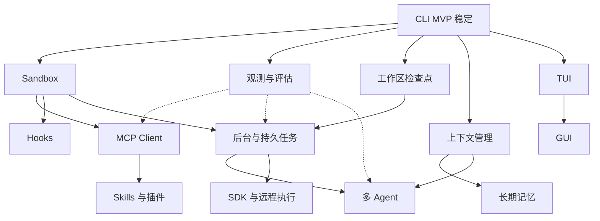

# 后续能力路线图

**规划日期：2026-11-06；状态：后续功能规划，全部尚未实现。**

本文回答“CLI MVP 之后，Saya Harness 还需要开发哪些能力”。Sandbox 与 MCP 是本轮明确提出的重点，见[决策记录](decisions.md) D-028；其他模块是围绕运行时扩展形成的配套规划。下面的范围、优先级和技术方向是开发规划，不自动成为某个版本的完整发行承诺。

已确认的 0.1 行为继续以[完整基线](mvp-baseline.md)和 D-027 为准。MVP 的 P0–P7／DEV 任务仍见[实施计划](implementation-plan.md)；本文不改写它们，也不将后续能力加入 0.1。

## 总体顺序

| 批次 | 目标 | 主要能力 |
| --- | --- | --- |
| A：隔离与扩展基础 | 能约束实际执行，并接入外部能力 | Sandbox、MCP Client、Skills／插件、Hooks、统一凭据；观测与评估同步建设 |
| B：持续完成项目 | 能处理长上下文、多步骤和可恢复工作 | 工作区检查点、上下文管理、后台任务、联网读取、模型路由、项目索引／LSP |
| C：协作与丰富输入 | 能积累知识、分工并处理更多内容 | 长期记忆、多 Agent、多模态；浏览器交互按需求进入 |
| D：开放与部署 | 能被其他程序使用并扩展运行环境 | 稳定 SDK、本地服务／远程执行、更多平台与分发 |
| 界面演进线 | 提供更直观的交互 | CLI 稳定后推进 TUI，再做 GUI；逐步承接新增能力 |

批次表达优先级，不要求整批全部完成后才开始下一批。以依赖与单项交付为准；运行时能力无需等 GUI 完成，界面也无需等待所有扩展能力。

下图表示主要依赖，完整范围与依赖见能力总表。

## 能力总表

依赖栏中的 F 编号表示相应能力的接口或交付基础，具体增量可以先用替身验证。所有条目状态均为“规划”。

| 编号 | 能力 | 优先级 | 主要依赖 | 用户得到什么 |
| --- | --- | --- | --- | --- |
| F-01 | Sandbox 执行隔离 | 最先 | MVP 工具与权限 | 对进程的实际文件、网络和资源访问形成约束 |
| F-02 | MCP Client | 最先 | MVP 工具接口；本地隔离依赖 F-01，远程凭据管理依赖 F-18 | 接入已有工具服务，不逐个编写专用集成 |
| F-03 | Skills 与插件包 | 高 | MVP 指令加载；可执行扩展依赖 F-01、F-02 | 安装、启用和复用领域能力 |
| F-04 | Hooks 与自动化规则 | 高 | F-01、F-12 | 在运行事件前后执行用户定义的检查和动作 |
| F-05 | 工作区隔离、Diff 与检查点 | 高 | MVP 文件与执行记录 | 查看、比较和恢复受控文件改动 |
| F-06 | 上下文管理 | 高 | MVP 协议状态、F-12 | 长任务继续工作，控制上下文占用 |
| F-07 | 长期记忆与检索 | 中 | F-06 | 跨会话保留可管理、可追溯的项目知识 |
| F-08 | 后台与持久任务 | 高 | F-01、F-05、F-12 | 运行长任务、暂停、继续和管理任务队列 |
| F-09 | 多 Agent 协作 | 中 | F-01、F-05、F-06、F-08、F-12 | 将任务交给有独立上下文与预算的子 Agent |
| F-10 | 联网读取与浏览器 | 中 | F-01、F-02 | 获取网页资料，随后扩展到受控网页操作 |
| F-11 | 多模态与附件 | 中 | F-01、F-06 | 使用图片、PDF 和其他附件完成任务 |
| F-12 | 观测、回放与评估 | 贯穿各批次 | MVP 事件与日志 | 定位失败、比较效果、评估版本变化 |
| F-13 | 稳定 SDK、服务与远程执行 | 后期 | F-01、F-02、F-08、F-12 | 将 Saya 嵌入其他产品，管理远端任务 |
| F-14 | TUI 与 GUI | 独立界面线 | MVP 核心接口 | 直观管理会话、执行过程、确认与产物 |
| F-15 | 平台与分发完善 | 后期 | F-01、F-14 | 扩展系统支持、安装、更新与发行体验 |
| F-16 | 模型路由与故障切换 | 中 | F-06、F-12、F-18 | 按能力、预算和可用性选择已配置模型 |
| F-17 | 项目索引与 LSP 代码智能 | 高 | F-01、F-06 | 基于符号、引用和诊断理解代码，减少全文扫描 |
| F-18 | 统一凭据与身份管理 | 高，配套第一批 | MVP 配置；执行侧注入依赖 F-01 | 管理服务凭据、授权范围、续期与撤销 |

## F-01 Sandbox 执行隔离

**价值**：权限系统决定操作是否获准，sandbox 约束获准操作实际能够访问的资源。

首轮开发内容：

- 建立可替换执行后端，支持宿主测试后端与真正隔离的后端，明确展示当前后端和能力。
- 文件系统：工作区／临时目录、只读与可写挂载、宿主目录隔离、产物取回。
- 网络：禁网与显式开放策略；需要域名级规则时设计对应代理或过滤机制，不把端口规则描述成完整域名控制。
- 进程与资源：进程树清理、运行时间、CPU／内存／进程数量限制，以及环境和凭据注入范围。
- 支持能力探测；用户选择的隔离要求无法满足时明确失败，不静默换成无隔离宿主执行。

交付顺序：统一接口和测试 → 一个容器／隔离环境后端 → Linux 与 macOS 的支持矩阵 → 按实测考虑原生后端。Linux Landlock 可作为原生限制候选，具体能力取决于内核支持，不能直接当作 macOS 方案。依据 [Linux 内核文档](https://docs.kernel.org/userspace-api/landlock.html)。容器方案还需验证挂载、网络、daemon 与运行配置，参考 [Docker 隔离说明](https://docs.docker.com/engine/security/)和 [rootless 模式](https://docs.docker.com/engine/security/rootless/)，这里不指定用户安装某个运行时。

验收：子进程不能越过已声明的隔离边界，资源耗尽与取消能清理，所报告后端与实际运行一致。未来 sandbox 与 bypass 的组合要形成明确的版本契约；推荐保留所选隔离环境的硬边界。sandbox 只读能力不自动在现有 PLAN 中启用 exec。

## F-02 MCP Client

**价值**：让 Saya 作为 MCP 客户端／宿主，使用外部工具，而不是让用户为每种服务编写 Saya 专用工具。

增量顺序：

1. 本地 stdio：显式配置服务器、受控启动与关闭、能力协商、工具发现和调用。
2. 远程 Streamable HTTP：服务连接、OAuth 发现与登录、令牌续期／凭据清理、取消、错误和所协商版本的兼容行为。
3. Resources 与 Prompts：读取和选择资源／模板，明确来源与上下文占用。
4. 进一步支持输入请求、工具列表变化、订阅与长任务等已协商能力，不假定所有服务器实现相同子集。

核心交付：服务器管理、稳定工具命名与模型侧名称映射、schema 校验、输出大小／内容类型处理、权限判断、执行记录、取消和非交互需要输入时的结束行为。本地 MCP 服务器本身也是进程，其启动与生命周期需要纳入执行策略，不能只审查后续 tools/call。

技术调研优先评估官方 Rust SDK [rmcp](https://github.com/modelcontextprotocol/rust-sdk)。当前调研参考 MCP 2026-07-28 的 [stdio／Streamable HTTP](https://modelcontextprotocol.io/specification/2026-07-28/basic/transports)、[HTTP 授权](https://modelcontextprotocol.io/specification/2026-07-28/basic/authorization)与[工具规范](https://modelcontextprotocol.io/specification/2026-07-28/server/tools)；进入实施时锁定验证过的 SDK 与协议兼容矩阵，而不直接跟随 main。

验收：至少一个本地和一个远程测试服务器完成发现、调用、拒绝、取消与失败路径；同名工具不会冲突，外部工具不会绕开 Saya 的权限。服务器工具 annotations 只作为声明性信息，不能单凭只读提示获得更高权限；这也符合工具规范对不可信 annotations 的要求。

Saya 自身对外提供 MCP Server 放在 F-13 的集成方向中，不与首轮 MCP Client 混成一个交付项。

## F-03 Skills 与插件包

**价值**：将领域指令、工作流、工具连接与资源打包复用。

- Skills：显式启用的技能目录、元数据、按需加载的指令与引用资源、用户级／项目级作用域。
- 插件包：manifest、版本、依赖与能力声明，包含 Skills、MCP 配置、资源和可选 Hooks。
- 管理：从明确来源安装、列出、启停、更新和卸载，展示更新差异与来源；不自动执行安装包声明的任意脚本。
- 权限：加载指令不等于授予工具权限，项目包不能提升宿主策略；可执行部分通过受控进程／MCP 接入。

先实现声明式包与本地安装，再考虑分发索引、签名和生态管理；首轮不以原生动态库 ABI 作为插件边界。

验收：一个领域技能与一个包含 MCP 配置的插件能安装／启停／升级，来源与依赖可查，停用后不继续注入指令或启动进程。

## F-04 Hooks 与自动化规则

**价值**：在固定事件点执行格式化、验证、通知或组织级规则。

- 定义运行开始／结束、模型返回、工具执行前后、需要人工输入等事件。
- 区分观察型 Hook 与可阻止操作的检查型 Hook，明确失败、超时和输出格式。
- Hook 具有来源、执行环境、预算和日志；调用脚本同样进入 sandbox／权限处理。
- 支持用户配置事件与动作关联，防止递归触发和恢复后重复执行。
- Hook 可以提出拒绝或建议，不凭返回文本自动授予原本缺失的许可。

验收：格式化／检查示例正常工作；超时和拒绝可定位，Hook 不绕过执行记录，不造成事件递归。

## F-05 工作区隔离、Diff 与检查点

**价值**：用户能看清 Agent 做了什么，并对受控文件改动进行比较和恢复。

- Git 项目可使用独立 worktree；非 Git 工作区使用受控目录与文件快照策略。
- 在阶段或修改前建立检查点，展示增删改与可追溯产物；支持选择文件接受或恢复。
- 检测外部修改和合并冲突，恢复前检查当前文件版本，保护用户后续工作。
- 区分文件恢复与外部副作用：发出的请求、数据库变更等不能假装被文件回滚撤销。

验收：跨多轮任务可比较和恢复选定文件，既有用户修改保持可追踪，冲突不被静默覆盖。

## F-06 上下文管理

**价值**：长任务在预算内继续执行，用户能理解摘要和检索对上下文的影响。

- 上下文组成与占用可见：任务、指令、工具结果、附件、摘要与最近对话。
- 显式压缩与可配置自动压缩，保留核心约束、当前目标、未完成工具关联和必要协议状态。
- 对大工具输出做分页、引用与按需检索；原始记录保留，摘要能追溯到来源。
- 评估压缩前后是否丢失约束或关键事实；跨模型／协议迁移单列兼容能力，不随摘要功能默认开启。

验收：超长任务继续完成，预算与摘要来源可见，权限和 PLAN 约束不因压缩丢失。该能力属于后续版本对 MVP“不自动摘要”行为的明确扩展。

## F-07 长期记忆与检索

**价值**：跨会话复用项目知识，同时让用户能够查看和纠正记忆。

- 区分会话历史、项目记忆和用户级偏好，不把保存所有日志当作记忆系统。
- 支持记住、查看、编辑、删除和过期；每条知识带来源、作用域和更新时间。
- 先做可解释的文本检索，再按效果引入语义检索；不预先锁定向量数据库。
- 检索结果以带来源的数据加入上下文，不提升指令优先级或越过项目作用域。

验收：能命中并引用相关记忆，用户更正或删除后结果相应变化，不在无关项目自动使用受限内容。

## F-08 后台与持久任务

**价值**：将一次前台循环扩展成可以管理的长任务。D-029 已将不跨运行的后台工具纳入 MVP；下述跨运行持久队列和调度仍属于后续能力。

- 持久任务队列、后台 worker、任务状态与产物，支持提交、查看、取消、暂停和显式继续。
- 明确“恢复上下文”“继续未完成步骤”“重试已执行操作”的差别，结合执行意图／结果和幂等设计。
- 支持分步工作流、超时、预算与失败后人工介入，再增加手动触发、定时或事件触发。
- 记录触发来源、时区、执行身份与权限；任务不能自行从前台变成无限后台循环。

验收：重启后能查看并按规则继续，结果不明的外部副作用不自动重放；取消能结束对应进程与资源。

## F-09 多 Agent 协作

**价值**：将大任务分成可独立执行和核验的子任务。

- 父子任务、分工、消息、结果汇总、独立上下文与预算；对子任务数量和并发设上限。
- 子 Agent 的权限、网络、凭据与可访问文件不能自动高于父任务的授权范围。
- 独立 worktree／sandbox 与合并流程，避免多个 Agent 同时覆盖同一文件。
- 取消、失败、超时和资源预算向子任务传递，汇总结果仍需实际验证。

先做受控父子任务，再考虑多层委派与更复杂协作。验收包含两个独立改动的隔离、冲突处理、总预算与取消；子任务需要有可核验的产物与合并结果。

## F-10 联网读取与浏览器

**价值**：完成需要外部资料与网页交互的通用任务。

- 先实现搜索／URL 读取、来源引用、下载大小与类型限制、超时和内容提取，可先通过 MCP 服务验证实际需求。
- 网络访问与凭据归属可配置；网页内容作为工具数据，不作为能修改权限的指令。
- 后续再做隔离浏览器环境、页面操作、截图与下载，明确需要用户介入的认证与外部修改。
- 浏览器状态和文件产物进入任务记录，断连或恢复不自动重复提交操作。

验收：来源可追溯、网络策略生效、动态网页失败可理解，涉及实际网页修改时有对应许可与执行证据。

## F-11 多模态与附件

**价值**：在文本之外使用图片、PDF 等输入完成真实工作。

- 附件的导入、引用、大小／类型检查、存储与生命周期，避免把所有文件直接拼进文本。
- 先做图片与 PDF，按需求增加音频、视频及其他文档解析。
- 按模型 profile 的实际能力适配内容，无法处理时明确说明，不静默遗漏附件。
- 文档解析过程进入受控环境，提取内容有来源、页码或时间位置，计入上下文预算。

验收：至少一个图片任务和一个多页文档任务完整往返，引用定位正确，恢复后附件关联保持有效。

## F-12 观测、回放与评估

**价值**：持续回答“为什么失败”“改版是否更好”“消耗发生在哪里”。

- 模型、核查、工具、权限、sandbox、MCP 与 Hook 的关联 trace 和执行时间线。
- 不执行副作用的历史回放、输入输出检索、失败定位、用量与费用归因。
- 固定任务集、协议夹具、权限／恢复回归和模型质量评估；版本之间可比较。
- 事件／报告导出可配置，保留脱敏与用户控制；不因增加观测功能自动上传遥测。

该能力从第一批持续建设。验收以可复现的失败定位、无副作用回放及版本回归报告为准，不用单一成功率掩盖权限或数据一致性问题。

## F-13 稳定 SDK、服务与远程执行

**价值**：让其他程序能够使用 Saya，并将执行位置从当前终端扩展出去。

- 先收敛嵌入式 SDK 的运行、控制、事件、错误与兼容策略，区别于 MVP 开发期可调整的内部 Rust API。
- 再做本地服务与任务查询，支持客户端断开后可理解的任务生命周期。
- 按需求增加远程 worker、工作区／产物同步、执行身份、凭据与配额隔离。
- Saya 作为 MCP Server 对外提供任务能力属于这一层的可选入口，不能通过暴露接口绕开原权限与 sandbox。

验收：一个外部程序能通过 SDK／服务执行和取消任务，断连、重连及远端失败不会丢失状态或重复副作用。

## F-14 TUI 与 GUI

**价值**：让已形成的运行时能力有清楚的交互入口。

- TUI：会话／任务、流式对话、工具调用、模式、确认／澄清、检查点与后台状态。
- GUI：在 TUI 复用核心得到验证后，增加工作区、设置、插件／MCP 管理、附件、产物和轨迹界面。
- 界面通过同一核心命令／事件／控制接口工作；增加面板不复制一套权限或执行循环。
- 新能力按可用性逐步进入界面，不要求先实现所有扩展才能交付 TUI。

验收复用核心行为与权限用例，并覆盖交互、退出清理、可访问性和恢复。界面框架在对应阶段验证后选定。

## F-15 平台与分发完善

**价值**：让开发者在更多环境中可靠安装、更新和运行。

- 先维护已确认 macOS／Linux 目标，完善安装、签名／校验、依赖诊断与升级迁移。
- 按需求增加 Windows、其他 Linux 发行环境与架构，分别验证命令、锁、信号、sandbox 和路径语义。
- 将平台能力差异做成明确的支持矩阵，不用“能编译”代替隔离与恢复功能支持。

验收以干净环境安装、升级、回退和平台测试为准；新系统支持不改变 0.1 的已有目标定义。

## F-16 模型路由与故障切换

**价值**：在多个已配置模型之间管理能力、可用性与消耗，不把所有任务固定到同一配置。

- 按任务类型、工具／多模态能力、上下文需求与预算选择候选 profile，提供显式路由与可解释的选择记录。
- 区分执行、规划与核查角色的模型配置；记录实际服务、模型、请求与成本归属。
- 健康状态、限流和暂时错误可触发已配置的回退策略，不自动选择未知账号或额外付费服务。
- 模型回退不能导致工具副作用重放。含不透明协议状态时，明确选择兼容迁移或新建会话，不能只替换模型名称。

验收：能力不匹配被排除、回退有记录、总预算仍生效，不能迁移的历史得到明确处理。MVP 仍保留不自动回退、不在同一会话切换模型／协议的基线，本能力在后续版本单独扩展。

## F-17 项目索引与 LSP 代码智能

**价值**：为 CODE／BUILD 提供项目结构和语言语义，减少反复全文搜索和不准确的代码定位。

- 文件／符号索引、增量更新与失效机制，遵守工作区范围、忽略规则和版本信息。
- 接入语言服务器以提供定义、引用、工作区符号和诊断；协议入口参考 [LSP 官方项目](https://github.com/microsoft/language-server-protocol)，实施时再验证所用语言服务器与协议能力。
- 语言服务器的进程、索引缓存和资源消耗纳入执行环境；查询结果带文件与位置来源。
- 将检索结果按需注入上下文；语言服务器给出的编辑建议仍通过文件版本检查与权限处理。

验收：至少一个 Rust 项目能完成定义／引用／诊断查询，文件修改后索引及时更新；过期索引不静默覆盖当前文件，PLAN 的缓存仍保存在目标工作区外。

## F-18 统一凭据与身份管理

**价值**：为模型、MCP、插件与远程任务提供一致的凭据生命周期和作用域。

- 在 MVP 的环境变量引用之上增加系统凭据存储或受支持的安全后端，配置与会话只保存引用。
- 管理 OAuth 登录、令牌续期、清除／撤销与账号切换；显示凭据用途和授权范围。
- 按服务、项目、工具与任务限定可用凭据，向 sandbox／子任务进行受控注入，不把全部宿主凭据交给每个进程。
- 保持模型上下文、核查输入、日志、导出和执行记录的已知凭据脱敏；凭据后端不可用时明确报错。

验收：权限范围、轮换与撤销即时反映到后续调用，恢复会话不恢复旧许可，测试凭据不出现在上下文、日志与数据库中。后端和保存格式在对应设计中验证，不改变 MVP 仅引用环境变量的默认行为。

## 第一批实际应准备的交付

CLI 基线稳定后，优先准备以下内容，而不是直接同时实现全部规划：

1. F-01：执行后端接口、一个隔离后端及文件／网络／资源边界测试。
2. F-02：本地 stdio MCP Client，受控服务器启动、工具发现、权限与调用记录；随后远程 HTTP 与鉴权。
3. F-03：一个可安装的 Skills／插件样例，复用已有 MCP 工具，而不增加专用接入代码。
4. F-04：工具前后 Hook 示例及超时／拒绝行为。
5. F-12：上述功能的 trace、离线回归与兼容报告。
6. F-18：在远程 MCP 与插件需要保存／续期令牌前，补齐凭据引用、存储与撤销基础。

进入任一模块时，将该项细化为设计、依赖验证、实现与验收任务；需要改变现有行为的部分另记版本决策。本轮交付为功能规划文档，实际实施状态保持“规划／未实现”。

## 研究依据与维护

本规划已核对 MCP 传输、HTTP 授权、工具及官方 Rust SDK，以及容器与 Linux 原生限制的官方资料，链接位于相关条目。规范和 SDK 会变化，进入开发时记录所验证的版本；本文不把调研参考版本当作已经实现的兼容承诺。

进度仍由[开发进度](progress.md)记录。F-01 至 F-18 都是后续能力规划，不与 MVP 的 DEV-001 至 DEV-032 混用，不将规划状态标记为完成。
