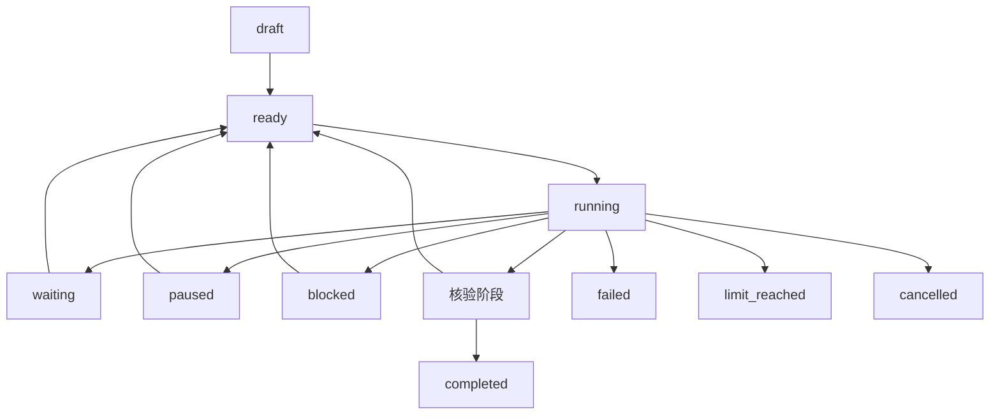

# Goal 目标编排设计

**状态为后续设计草案。项目负责人明确希望未来提供 `/goal`，能力编号 F-20，实现任务为 DEV-069 至 DEV-074。**

## 产品语义

Goal 保存目标、验收条件、步骤、预算和证据，关联一个工作区及多个 Run。PLAN、BUILD、CODE、WORK 继续表达某次执行的工作方式，界面可同时显示 Goal 状态和当前工作模式。

当前方案将目标生命周期放在应用／编排层，底层复用 AgentRuntime、工具派发、权限、取消和存储。首次交付以单目标串行步骤和手动继续为基础，随后增加显式授权的自动续跑。用户需求见[决策记录](decisions.md)，具体拆分是本设计的规划方案。

规划、核验与重规划提示词按 D-030 使用英文，模型建议通过结构化校验后交给编排服务。Compact 后从 Goal 持久记录与当前配置重建目标、验收项、权限和剩余预算，摘要内容保留来源与不确定状态。

## 三层交付

| 层次 | 交付范围 | 主要基础 |
| --- | --- | --- |
| G1 手动 Goal | 目标定义、计划、步骤、证据、手动执行与报告 | 共享应用服务、一致性快照、持久化和现有有界 Run |
| G2 有限自动 Goal | 自动推进、有限重规划、跨 Run 调度及显式恢复 | G1、Sandbox、检查点、Compact、持久 worker、总预算 |
| G3 多 Agent Goal | 子任务分工、依赖、隔离、汇总与独立验证 | G2 及 F-09 多 Agent 能力 |

G1 可在共享基础稳定后单独开发，G2 的执行依赖按[后续开发计划](post-mvp-plan.md)落实。TUI 的目标面板随可用服务开放。

## 数据与关联

| 对象 | 主要字段 |
| --- | --- |
| Goal | ID、objective、acceptance criteria、工作区、profile 引用、状态、阶段、预算、创建与更新时间 |
| Step | ID、依赖、说明、用户选定模式、状态、尝试次数、关联 Run、输入及产物引用 |
| Evidence | 验收项 ID、来源 Run／调用、文件与摘要、执行命令或核验方式、结果、核验时间 |
| Continuation | 手动／自动授权范围、当前调用权限引用、剩余预算、调度租约与暂停原因 |

第一轮实现可将一个 Goal 绑定到主要 Session，步骤关联多个 Run。跨 Session 关联及子 Goal 按实际需求扩展。工具调用继续使用 `(run_id, call_id)` 关联。

证据中的文件包含生成时摘要，核验时重新检查版本。计划完成、模型自述、命令退出码和目标验收分别记录，目标完成要求每条验收条件具有对应证据。

## 生命周期草案

| 状态 | 含义与后续动作 |
| --- | --- |
| draft | 目标已保存，等待计划及验收条件收敛 |
| ready | 当前步骤及授权范围已明确，等待启动 |
| running | 正在规划、执行、核验或有限重规划，具体阶段单独记录 |
| waiting | 等待确认、输入或外部条件，记录 wait reason 与对应请求 |
| paused | 用户暂停或当前 Run 被停止，等待显式继续 |
| blocked | 前置条件无法推进，记录原因及可执行的恢复入口 |
| completed | 验收条件及证据全部满足 |
| failed | 遇到终止性错误，保留已完成步骤与产物 |
| cancelled | 用户取消，完成受管理资源清理并保存实际结果 |
| limit_reached | 预算或尝试上限到达，等待用户处理目标 |



暂停、取消和预算停止首先关闭新调度，再传播到当前 Run 及后台任务，清理结束后保存状态。进程结果无法确认时记录 unknown，并保留实际清理证据。

## 用户入口草案

交互入口与 CLI 子命令使用同一应用服务。

```text
/goal create "Deliver a Rust API with tests and documentation"
/goal plan GOAL_ID
/goal list
/goal status GOAL_ID
/goal continue GOAL_ID
/goal pause GOAL_ID
/goal resume GOAL_ID
/goal cancel GOAL_ID
/goal report GOAL_ID
```

```sh
# 以下为后续接口草案
saya goal create "Deliver a Rust API with tests and documentation"
saya goal plan GOAL_ID --mode plan
saya goal continue GOAL_ID --mode build
saya goal report GOAL_ID
# 自动阶段开放后的显式启动入口
saya goal start GOAL_ID --auto --mode build
```

创建先保存目标。计划生成和步骤执行各自由明确操作启动，G1 的 continue 执行一个步骤后返回。恢复加载状态、当前配置和证据，随后等待继续指令。`saya resume SESSION_ID` 使用会话恢复语义。

## 权限、模式与预算

- 计划、模型输出和验收结果作为数据进入编排服务，工具权限仍由当前运行策略决定。Manual Approval 逐工具确认，PLAN、deny 以及选定隔离后端的边界在实际派发处验证。
- 模式来自用户选择。自动阶段的首版建议使用用户选定的固定执行模式，模式调整由 Agent 提议并等待用户确认，在调用边界生效。
- 自动继续需要独立、有限的启动授权，记录目标、工作区、执行身份、配置指纹和预算。恢复按本次调用权限重新判定工具许可。
- 每个 Run 保有模型、工具、活跃时间和清理上限。Goal 总预算另外累计 Run 数、请求、工具、活跃时间、规划／核验／压缩及重规划尝试，费用继续标记为估算。
- 可声明为硬上限的资源在执行前预留、执行后结算，未知用量和中断记录按保守策略处理。具体单位、缺失 usage 行为和默认上限在 DEV-069／DEV-072 收敛。
- 重试和重规划具有次数上限、失败分类及停止原因。结果不明的副作用进入等待处理，重试前先检查已有意图、结果和幂等记录。

## 持久化与恢复

Goal、Step、Run 关联和调度意图通过版本化数据库迁移加入，按现有备份与事务约定执行。目标状态改变与步骤启动意图在事务内保存，之后调用运行服务。写入失败停止后续调度。

每个 Goal 同时运行一个受管理 Run，持有目标排他控制和现有 Session 写锁。跨 Goal 的同工作区写入需要 F-05 的隔离或显式排他策略。worker 租约恢复需核对进程身份、执行记录和授权范围，丢失连接的执行标记为待核对。

G2 引入持久队列后，再根据明确的自动授权恢复调度。0.1.0 运行内后台任务的结果作为原有 Run 数据记录，其现有结束清理语义在适用运行中继续执行。

## 验收

DEV-069／070 验证创建、计划、逐步执行、模式选择、证据、单目标锁和手动恢复。DEV-071／072 注入 worker 崩溃、调用已开始但结果未保存、未知副作用、预算耗尽、过期授权和核验失败。DEV-073／074 验证 TUI／CLI 的一致视图、报告导出和全生命周期。

完成判断包括需求对应、真实产物、指定验证及证据版本。模型声称完成但证据缺失的案例应保持在待核验或待处理阶段。所有测试默认采用可控模型、时钟、临时工作区和受控执行后端。
