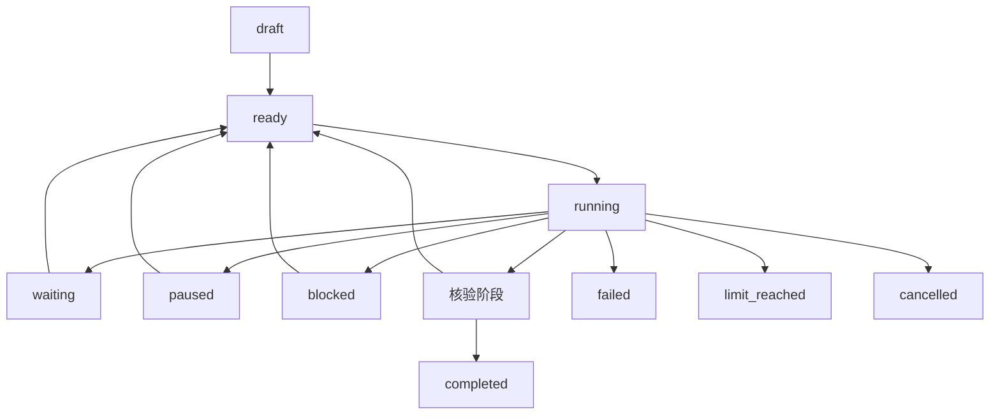

# Goal 目标编排设计

**状态：DEV-069 至 DEV-074 已实现并通过本机受控验收。能力编号 F-20；跨平台固定源码证据和发行版本仍按验收记录单独维护。**

## 当前实现

Goal 使用独立、版本化的 `data_dir/goals/goals.sqlite3`。数据库采用 WAL、私有目录／文件权限、显式 application ID／schema version、版本 CAS、单 Goal worker 租约和 dispatch intent。Goal 绑定一个专属 Session 与工作区，步骤按依赖串行复用现有 AgentRuntime、工具派发、权限、隔离、Compact、检查点及 Session 锁。

CLI 与 TUI 共用 `saya-core::goal` 数据／存储和 `saya-app::goal` 计划／运行编排。模型计划与人工证据核验使用无工具、纯英文请求；模型输出只是候选数据，必须经过严格 schema 校验。步骤完成、Run 完成及 Goal 验收分别记录，模型自述或计划文字不能单独令 Goal 完成。

当前入口：

```sh
saya goal create "OBJECTIVE" [--accept TEXT]...
saya goal plan GOAL_ID [--plan-file PLAN.json]
saya goal confirm GOAL_ID
saya goal list
saya goal status GOAL_ID
saya goal continue GOAL_ID [--approval-file PATH]
saya goal start GOAL_ID --auto
saya goal pause|resume|cancel GOAL_ID
saya goal verify GOAL_ID CRITERION [--summary TEXT]
saya goal resolve GOAL_ID STEP_ID --retry
saya goal replan GOAL_ID
saya goal report GOAL_ID [--format json|markdown] [--file PATH]
saya goal worker [--once]
```

TUI 提供 `/goals` 选择器与 `/goal create|plan|confirm|status|continue|start|pause|resume|cancel|verify|report|replan ID`。TUI 的交互式 Goal Run 当前要求 `auto` 或 `bypass` 权限；`Manual Approval` 使用 CLI 的终端审批路径。自动启动必须显式执行 `start --auto`，不会由普通发送或后台恢复隐式产生。

核验只在全部 Step 完成后开放。人工条件要求 `--summary`（TUI 为条件 ID 后的文字）并经过独立无工具核验；文件条件不接受人工摘要，`goal verify GOAL_ID CRITERION` 直接由主机重新读取文件。暂停会保留当前等待原因，恢复等待计划确认或验收的 Goal 时仍回到对应 Waiting，不会绕过确认。运行中的暂停／取消会持久化控制意图并传播到当前 Runtime；取消为终态并撤销自动授权。

实现和验收细节见[N4验收](n4-validation.md)。

## 产品语义

Goal 保存目标、验收条件、步骤、预算和证据，关联一个工作区及多个 Run。PLAN、BUILD、CODE、WORK 继续表达某次执行的工作方式，界面可同时显示 Goal 状态和当前工作模式。

当前方案将目标生命周期放在应用／编排层，底层复用 AgentRuntime、工具派发、权限、取消和存储。首次交付以单目标串行步骤和手动继续为基础，随后增加显式授权的自动续跑。用户需求见[决策记录](decisions.md)，具体拆分是本设计的规划方案。

规划与核验提示词按 D-030 使用英文，模型建议通过结构化校验后交给编排服务。当前重规划采用有界、保守的失败修正：只对已持久化且非 unknown／取消的失败步骤追加“先检查现状、不得重放未确认副作用”的修正指令，并受 `max_replans` 限制；unknown 副作用进入等待，不自动重试。Compact 后从 Goal 持久记录和当前配置恢复目标、验收项、权限与剩余预算。

## 三层交付

| 层次 | 交付范围 | 主要基础 |
| --- | --- | --- |
| G1 手动 Goal | 目标定义、计划、步骤、证据、手动执行与报告 | 共享应用服务、一致性快照、持久化和现有有界 Run |
| G2 有限自动 Goal | 自动推进、有限重规划、跨 Run 调度及显式恢复 | G1、Sandbox、检查点、Compact、持久 worker、总预算 |
| G3 多 Agent Goal | 子任务分工、依赖、隔离、汇总与独立验证 | G2 及 F-09 多 Agent 能力 |

G1 可在共享基础稳定后单独开发，G2 的执行依赖按[后续开发计划](post-mvp-plan.md)落实。TUI 的目标面板随可用服务开放。

## 数据与关联

| 对象 | 主要字段 |
| --- | --- |
| Goal | UUID、专属 Session、objective、acceptance criteria、工作区、profile、模式、状态／阶段、预算／usage、当前 Step、wait／failure、auto authorization、revision、创建／更新时间 |
| Step | UUID、ordinal、依赖、标题／指令、运行模式、状态、尝试次数、关联 Run、最近结构化 Run 结果 |
| Evidence | UUID、验收项 ID、来源 Step／Run、manual／file-exists／file-digest／artifact 类型、摘要、相对路径、SHA-256、核验时间 |
| Continuation | 显式 auto 标记、模式、权限模式、配置指纹、授权时间、worker owner／过期租约及持久 dispatch 状态 |

当前实现将一个 Goal 绑定到一个专属 Session，步骤关联多个 Run；跨 Session 关联及子 Goal 按后续需求扩展。工具调用继续使用 `(run_id, call_id)` 关联。

证据中的文件包含生成时摘要，核验时重新检查版本。中间 Step 只在文件条件已满足时记录证据，暂未满足不会阻断后续 Step；全部 Step 完成后会重新核验所有文件条件，文件变化或缺失会使旧证据失效。计划完成、模型自述、命令退出码和目标验收分别记录，目标完成要求每条验收条件具有与核验类型、路径及摘要匹配的证据。

## 生命周期草案

| 状态 | 含义与后续动作 |
| --- | --- |
| draft | 目标已保存，等待计划及验收条件收敛 |
| ready | 当前步骤及授权范围已明确，等待启动 |
| running | 正在规划、执行、核验或有限重规划，具体阶段单独记录 |
| waiting | 等待确认、输入或外部条件，记录 wait reason 与对应请求 |
| paused | 用户暂停或当前 Run 被停止，等待显式继续 |
| blocked | 前置条件无法推进，记录原因及可执行的恢复入口 |
| completed | 验收条件及证据全部满足 |
| failed | 遇到终止性错误，保留已完成步骤与产物 |
| cancelled | 用户取消，完成受管理资源清理并保存实际结果 |
| limit_reached | 预算或尝试上限到达，等待用户处理目标 |



暂停、取消和预算停止首先关闭新调度，再传播到当前 Run 及后台任务，清理结束后保存状态。进程结果无法确认时记录 unknown，并保留实际清理证据。

## 用户入口草案

交互入口与 CLI 子命令使用同一应用服务。

```text
/goals
/goal create Deliver a Rust API with tests and documentation
/goal plan GOAL_ID
/goal confirm GOAL_ID
/goal status GOAL_ID
/goal continue GOAL_ID
/goal start GOAL_ID
/goal pause|resume|cancel GOAL_ID
/goal verify GOAL_ID criterion-1 Reviewed evidence
/goal report GOAL_ID
```

```sh
saya goal create "Deliver a Rust API with tests and documentation"
saya goal plan GOAL_ID
saya goal continue GOAL_ID
saya goal report GOAL_ID
saya goal start GOAL_ID --auto --mode build
saya goal worker
```

创建先保存目标。计划生成和步骤执行各自由明确操作启动，G1 的 continue 执行一个步骤后返回。恢复加载状态、当前配置和证据，随后等待继续指令。`saya resume SESSION_ID` 使用会话恢复语义。

## 权限、模式与预算

- 计划、模型输出和验收结果作为数据进入编排服务，工具权限仍由当前运行策略决定。Manual Approval 逐工具确认，PLAN、deny 以及选定隔离后端的边界在实际派发处验证。
- 模式来自用户选择。自动阶段的首版建议使用用户选定的固定执行模式，模式调整由 Agent 提议并等待用户确认，在调用边界生效。
- 自动继续需要独立、有限的 `start --auto` 启动授权，记录模式、权限、profile／权限规则／沙箱／运行上限构成的配置指纹和预算。worker 或手工恢复时重新判定当前权限；配置变化会令自动 Goal 进入 `blocked / authorization`，需人工恢复并重新显式授权。
- 自动启动前核验所选后端的文件、网络、资源和清理能力，硬要求缺失时给出可处理原因。best_effort 的资源与清理能力按显式 profile 展示，具体矩阵见[原生后端设计](sandbox.md)。
- 每个 Run 保有模型、工具、活跃时间和清理上限。Goal 总预算累计 Run 数、模型请求（含 review／plan／compaction）、工具、活跃时间、输入／输出 token、规划／核验尝试及重规划；达到任一硬上限后，在下一个 Step dispatch 前停止新调度。
- 成功规划、执行或人工核验缺少完整 input／output token usage 时，记录 `token_usage_unknown` 并保守停止后续 Step 调度，不按零用量处理。已知失败 Run 保留已观察用量，是否重试仍由 unknown 边界和 `max_replans` 单独约束。
- `continue --approval-file` 的预授权只适用于该次 Run；`start --auto --approval-file` 只装入自动序列的第一个 Run，不会在后续 Step 重新加载或恢复已消费授权。
- 重试和重规划具有次数上限、失败分类及停止原因。结果不明的副作用进入等待处理，重试前先检查已有意图、结果和幂等记录。

## 持久化与恢复

Goal、Step、Run 关联和调度意图位于独立版本化数据库，按事务和配置化 redaction 保存。目标状态改变与步骤启动 intent 在事务内提交，之后才调用运行服务；写入失败停止后续调度。状态更新使用 revision CAS，验收证据与 completion 在同一事务内发布。

每个 Goal 同时运行一个受管理 Run，持有 Goal lease 和现有 Session 写锁。worker 心跳续租；续期失败会立即请求取消当前 Run，避免失去排他所有权后继续执行。只恢复租约已过期的 dispatch。intent／running 未得到终态的 dispatch 标为 unknown，并等待 `goal resolve --retry`，不会自动重放。`goal continue` 与 TUI 前台执行使用同一租约和 Session 锁边界。

G2 引入持久队列后，再根据明确的自动授权恢复调度。0.1.0 运行内后台任务的结果作为原有 Run 数据记录，其现有结束清理语义在适用运行中继续执行。

## 验收

DEV-069／070 验证创建、计划、逐步执行、模式选择、证据、单目标锁和手动恢复。DEV-071／072 注入 worker 崩溃、调用已开始但结果未保存、未知副作用、预算耗尽、过期授权和核验失败。DEV-073／074 验证 TUI／CLI 的一致视图、报告导出和全生命周期。

完成判断包括需求对应、真实产物、指定验证及证据版本。模型声称完成但证据缺失的案例应保持在待核验或待处理阶段。所有测试默认采用可控模型、时钟、临时工作区和受控执行后端。
