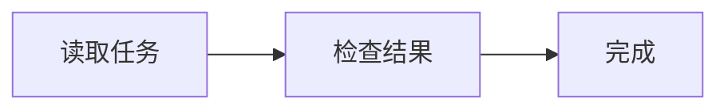

# Markdown 显示与本地预览

本文说明0.2.0之后本地开发线的Assistant正文显示。实现与本机验证状态见[开发进度](progress.md)。显示属于TUI视图投影，会话、导出及模型历史保存原始消息。

## Source 与 Render

默认采用render显示。`/markdown source`切换为源码视图，`/markdown render`恢复排版，命令补全和Ctrl+P面板提供对应入口。设置在本次TUI中生效，新建或恢复会话沿用当前选择。用户、工具和Thinking卡片保持各自的原文显示方式。

## 语法范围

| 语法 | 显示行为 |
| --- | --- |
| 普通段落、软换行、硬换行 | 随可用终端宽度换行，保留显式换行 |
| ATX标题 `#` 至 `######` | 标题色与加粗 |
| Setext标题 `===`／`---` | 按上下文识别一级／二级标题 |
| `**bold**`、`__bold__`、`*italic*`、`***text***` | 加粗、斜体及组合样式 |
| `~~text~~` | 删除线 |
| 行内代码与围栏代码 | 保留代码字面内容和代码背景 |
| 代码语言高亮 | 使用内置语法与深色主题，Rust、Python、JavaScript、JSON等按语言token着色 |
| 缩进代码块 | 按代码字面内容显示 |
| 无序、有序及多级列表 | 保留层级、序号和悬挂缩进 |
| 任务列表 `- [ ]`／`- [x]` | 显示待完成／已完成标记及状态颜色 |
| 引用与嵌套引用 | 采用按层级排列的竖线前缀 |
| 分隔线 | 按可用宽度显示横线 |
| GFM管道表格 | Unicode列宽、左／中／右对齐、换行及窄屏逐字段布局 |
| 普通、带title及引用式链接 | 显示标签和可见目标地址，采用蓝色下划线 |
| 自动链接 | 支持尖括号URL、邮箱及裸HTTP(S)地址 |
| 图片 | 显示Image说明、alt文字及目标地址 |
| HTML标签、字符实体 | 显示源码，字符实体保留原始拼写 |
| 脚注 | 按消息编号、关联定义，并提供点击和命令跳转 |

字符实体保留源码可以避免排版阶段重新生成已净化的终端控制字符或编码凭据。所有解析后的文本、地址及语言标签继续经过终端控制字符净化。

代码高亮采用每块32KiB、每逻辑行2048字节、每行256个span及每块4096个span的预算。未知语言、解析失败或预算超限时，整块采用普通代码样式，代码内容继续显示。

## 脚注导航

```markdown
正文中的脚注[^runtime]，同一脚注还可以重复引用[^runtime]。

[^runtime]: 定义可以包含加粗、链接、列表和多个段落。
```

编号按本条消息首次引用顺序分配。点击正文编号跳到定义，点击定义编号返回对应引用。`/footnote NUMBER`跳到最近一条具有该编号的Assistant消息，`/footnote back`返回上一位置。恢复、窗口重排和表格换行后，位置依据消息ID及语义锚重新计算。source视图显示原始标记，代码中的字面脚注和未定义脚注显示为文本。

## Unicode 数学

支持行内 `$x^2$`、`\(x^2\)`，块级 `$$...$$`、`\[...\]`，以及语言为math、latex或tex的围栏。Unicode子集包含常用希腊字母、数学运算与关系符号、分数、根式、可表示的上下标、部分字体和重音命令，以及有界矩阵、aligned、cases和boxed显示。

````markdown
行内公式 $x^2 + \alpha$。

\[\frac{a+b}{c}\]

```math
\begin{pmatrix}a & b \\ c & d\end{pmatrix}
```
````

分数与根式带明确的分组边界。Unicode没有对应字符的脚标、未知命令、缺少参数、嵌套字体宏、不可保真的二维组合及超出视口的块公式整体回退源码。行内回退采用代码样式，块级回退显示带source fallback标记的代码卡片。数学输入限16KiB、深度24、输出64KiB，矩阵最多16行×16列。

## Mermaid 图表

mermaid围栏在终端内生成Unicode字符图，当前支持flowchart／graph、sequenceDiagram、stateDiagram、classDiagram和erDiagram。完整图表应能放入扣除列表／引用前缀后的可用宽度。其他类型、解析错误、空图、尺寸超限或不安全的配置／字符实体整体显示原代码卡片及source fallback标记。



图表在布局前检查8KiB源文本、128行、512词法token、16层括号，以及32节点、64边和128明细预算。输出限240列×128行及128KiB，超限沿源码回退。YAML引用扩展、实体、HTML标签和强调标记采用保守源码回退，避免库内的文本解码和剥离改变已处理内容。此检测也会使 `#fff` 等颜色配置回退源码。渲染使用进程内Rust实现，输出采用普通Unicode文本。

## 显示与缓存预算

CommonMark输入最多256KiB、65,536事件、64层结构，保留最近10,000个物理显示行。表格最多32列／4096单元格，以前128行估算列宽，单列目标宽度上限48，单元格保留末128行，超限有省略提示。原始消息可通过source视图或会话导出查看。

最近16条Assistant消息使用有界排版缓存，按消息ID、源码指纹和宽度失效。缓存合计限制10,000行、2MiB已分配文本、65,536个span与4096个脚注锚。新建／恢复、源码更改、驱逐和source切换沿各自的失效路径清理缓存。

## Debug 预览

在真实终端中运行以下命令。

```sh
just tui-preview syntax
just tui-preview working
just tui-preview completed
just tui-preview approval
just tui-preview attachments
just tui-preview background
just tui-preview memory
just tui-preview skills
./target/debug/saya tui-preview math
./target/debug/saya tui-preview mermaid
./target/debug/saya tui-preview footnotes --source
```

`saya tui-preview [SCENE] [--source]`由 `cfg(debug_assertions)`控制，默认开发构建提供该子命令。优化构建的命令目录按关闭debug assertions的配置生成。该入口使用共享的静态场景，在读取运行配置、初始化日志与打开会话之前分派。

共享场景同时覆盖UI壳层：`approval`、`question`与`background`展示居中弹窗，`attachments`展示图片／文件token高亮，`help`与`tool`展示详情侧栏，`commands`与`completion`展示覆盖层，`memory`及`skills`／`mcps`／`plugins`／`sessions`展示各自弹窗，`sidebar`展示宽屏信息栏。所有场景调用生产`view::draw`，不发起模型或存储请求。

←／→切换场景，s／r切换source／render，Home／End及方向键、PgUp／PgDn和滚轮移动视口，点击脚注或b键导航，q／Esc／Ctrl+D退出，Ctrl+C和终止信号按130退出并恢复终端。

现有render_preview例子共用相同场景，支持文本输出和包含单元格位置、颜色及修饰的JSON快照。

```sh
MACOSX_DEPLOYMENT_TARGET=15.0 cargo run -p saya-tui --example render_preview -- 140 60 syntax
MACOSX_DEPLOYMENT_TARGET=15.0 cargo run -p saya-tui --example render_preview -- 140 60 math --source
MACOSX_DEPLOYMENT_TARGET=15.0 cargo run -p saya-tui --example render_preview -- 140 60 mermaid --json
```

新增场景包含syntax、syntax-blocks、syntax-lists、syntax-links、footnotes、math、mermaid、mermaid-sequence、mermaid-state、mermaid-class、mermaid-er及mermaid-fallback。原有聊天、工具、审批和布局场景继续通过同一目录发现。

实现使用pulldown-cmark解析CommonMark／GFM、Syntect处理内置语法高亮、merman-core与mermansi处理图表语义和终端布局，Unicode数学采用严格的本地转换器。[解析选项](https://docs.rs/pulldown-cmark/latest/pulldown_cmark/struct.Options.html)、[高亮接口](https://docs.rs/syntect/5.3.0/syntect/easy/struct.HighlightLines.html)、[Mermaid接口](https://docs.rs/mermansi/0.1.6/mermansi/)
