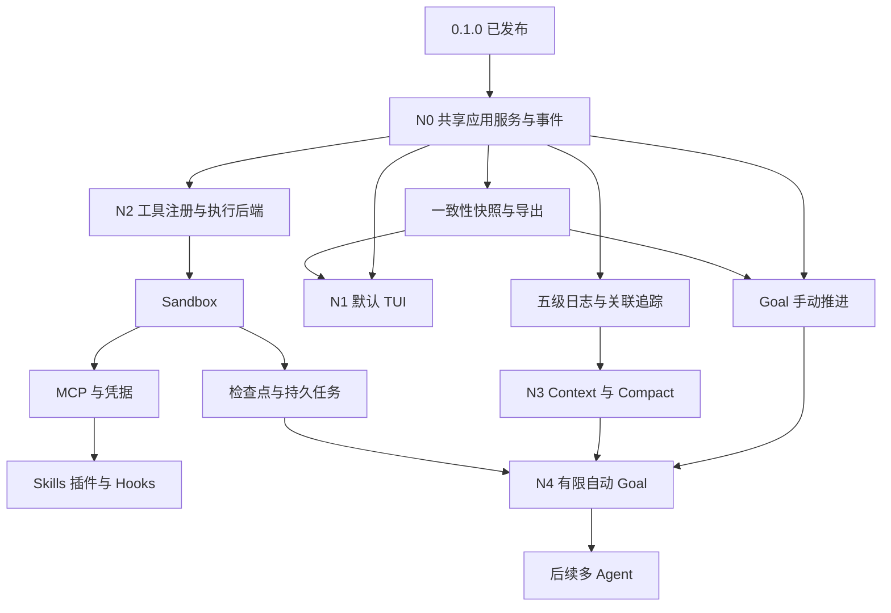

# 0.1.0 之后的开发计划

**制订于 2026-11-07。需求方向已明确，下面的版本分组、技术方案和 DEV-038 至 DEV-074 均为开发规划，实际进度见[开发进度](progress.md)。**

需求来源为项目负责人本轮引用的[《Harness功能设计》对话](chatgpt-conversation://6aef3957-d280-83ee-9098-278ae10191f8)。本轮提取需求并核对本地源码，具体建议按设计草案记录。0.1.0 的发行证据见[发行验证](release-validation.md)，原 P0 至 P7 和 DEV-001 至 DEV-037 定义保存在[MVP 实施任务](implementation-plan.md)。

## 需求与现有基础

| 用户需求 | 已有基础 | 后续交付 | 文档 |
| --- | --- | --- | --- |
| 加入日志系统 | `JsonLog` 已有 warn／error、脱敏、轮转及跨进程写锁，CLI 记录异常结果 | 五级诊断日志、关联 span、筛选与跟随查询 | [日志与追踪](observability.md)，F-12 |
| Session 导出为 Markdown 或 JSON | SQLite 已保存历史、事件、调用、用量和后台结果，CLI 有 list／show | 一致性快照、独立导出格式、显式文件保存 | [会话导出](session-export.md)，新增 F-19 |
| 未来加入 `/goal` | 运行预算、会话恢复、四模式、运行内后台工具 | 目标、步骤、验收证据，随后增加受限自动续跑 | [Goal 编排](goal.md)，新增 F-20 |
| 直接输入 `saya` 进入 TUI | 当前无子命令进入文本 chat，顶层子命令已是 `Option<Command>` | 默认 TUI、流式对话、人工审批、会话与工具管理 | [TUI 设计](tui.md)，F-14 |

0.1.0 workspace 实际包含 `saya-core`、`saya-cli`。`main.rs` 的 `build_runtime`、模型包装和 `session.rs` 的会话准备是共享应用层的主要提取入口。`events.rs` 已有流事件、序号与脱敏路径，应在迁移时复用。`tracing` 和 TUI 依赖将在对应实现任务中引入并通过 Cargo.lock 固定。

## 交付分组

| 阶段 | 范围 | 主要任务 | 退出条件 |
| --- | --- | --- | --- |
| N0 共享基础 | 应用服务、事件桥接、日志、Session Export | DEV-038 至 DEV-046 | 现有 CLI 正常运行，日志及导出有离线证据 |
| N1 默认 TUI | 终端生命周期、聊天、审批、会话、入口路由 | DEV-047 至 DEV-053 | 直接运行 `saya` 打开 TUI，四平台交互验收通过 |
| N2 隔离与工具扩展 | Tool Registry、执行后端、Sandbox、MCP、凭据 | DEV-054 至 DEV-061 | 获准操作受到实际隔离，外部工具走统一调度 |
| N3 上下文与扩展包 | Context Builder、Compact、检查点、Skill 激活、saya-plugin、Hooks | DEV-062 至 DEV-068 | 长上下文与可执行扩展具有可追溯、可恢复的边界 |
| N4 目标编排 | Goal 数据、手动推进、持久任务、有限自动续跑与报告 | DEV-069 至 DEV-074 | 目标完成由验收证据判定，预算、恢复及授权可验证 |

N0 与 N1 是 **0.2.0 的候选范围**。实际发版根据验收结果决定。N2 的接口设计可以在 N0 后开展，Sandbox／MCP 的交付优先级为高。N3、N4 按任务依赖进入开发，后续版本号在发行范围收敛时确定。

Goal 的手动阶段可在应用服务与快照稳定后单独推进。持久自动续跑以执行隔离、检查点、上下文管理和持久调度为前提。多 Agent Goal 的后续工作归 F-09。

## N0 共享基础

| 任务 | 内容 | 最小依赖 | 交付与验证 |
| --- | --- | --- | --- |
| DEV-038 | 提取 `saya-app` 共享应用服务 | 0.1.0 | 迁移 profile／模型组装、会话创建／恢复与锁的生命周期。CLI 测试覆盖模式覆盖、配置变更、PLAN 数据目录与恢复行为 |
| DEV-039 | 统一应用命令、流事件、人工输入与控制桥接 | DEV-038 | 复用 EventWriter／EventModel 和 RuntimeHandle。三协议文本流、序号、审批失效、取消与消费者断开通过受控测试 |
| DEV-040 | 扩展安全日志为五级类型化记录 | 0.1.0 | 保留现有日志路径、跨进程锁和 10 MiB／5 备份边界。验证级别、字段白名单、嵌套凭据与轮转 |
| DEV-041 | 接入 tracing span 与安全 subscriber | DEV-039、DEV-040 | 关联 session／run／request／call／job，异步任务归属正确。元数据经过安全记录层，压力下资源有界 |
| DEV-042 | 日志级别及 show／tail 查询 | DEV-040、DEV-041 | 提供 `--log-level`、`SAYA_LOG_LEVEL` 和本地筛选。验证轮转跟随、退出、损坏尾行、终端转义与 JSON／JSONL stdout |
| DEV-043 | 实现只读一致性 Session Snapshot | 0.1.0 | 单次读事务读取全部集合及持久化水位。并发写入、活跃会话、旧 schema、取消与读取上限有测试 |
| DEV-044 | 版本化 JSON 导出器 | DEV-043 | 独立 `saya.session` schema、范围与内容选择、复合调用 ID、未知状态及省略字段可验证 |
| DEV-045 | Markdown 导出器 | DEV-043、DEV-044 | 复用同一快照和过滤策略。验证 Unicode、代码围栏、HTML／控制字符和长工具输出 |
| DEV-046 | CLI 导出与安全文件发布 | DEV-044、DEV-045 | `session export --file` 接入。验证原子发布、已有文件、链接、私有权限、磁盘失败、取消、PLAN 路径和无模型调用 |

## N1 默认 TUI

| 任务 | 内容 | 最小依赖 | 交付与验证 |
| --- | --- | --- | --- |
| DEV-047 | 建立 `saya-tui` library 与终端生命周期 | DEV-038、DEV-039 | Ratatui／Crossterm 候选经验证后锁版本。状态更新与绘制分离，退出、错误、panic unwind 和信号恢复终端 |
| DEV-048 | 流式聊天、编辑与基础内容呈现 | DEV-047 | 多行输入、滚动、Unicode／窄终端、代码块及有限文本缓存。高频增量合并后最终文本完整 |
| DEV-049 | 模式、权限、确认／澄清和运行控制 | DEV-048 | 展示当前／待切换模式，Manual Approval 覆盖全部模型工具。取消优先、过期确认、后台清理及人工等待计时复用 core |
| DEV-050 | 会话浏览、工具详情、后台状态与导出入口 | DEV-046、DEV-049 | 新建／恢复等待输入，工具结果与 unknown 原样呈现。界面查看持久化记录与 Agent 工具调用有清楚关联 |
| DEV-051 | `saya` 默认入口切换与兼容处理 | DEV-050 | TTY 无子命令进入 TUI。非 TTY、管道输入和机器输出冲突返回用法错误。run／chat／resume／session／config 命令回归通过 |
| DEV-052 | TUI 与 CLI 四平台集成验收 | DEV-051 | PTY 故障注入、慢消费者、审批取消竞态、三协议和四模式／三权限回归，验证 stdout、退出与资源清理 |
| DEV-053 | 0.2.0 候选发行检查与双语说明 | DEV-042、DEV-046、DEV-052 | 更新使用指南和迁移说明，按选定版本构建四平台候选并验收。记录默认入口变化、安装、已知限制与证据 |

## N2 隔离与 MCP

| 任务 | 内容 | 最小依赖 | 交付与验证 |
| --- | --- | --- | --- |
| DEV-054 | 工具注册与可信操作描述 | DEV-039 | 本地与外部工具共享命名、schema、策略、取消及记录。只读声明经过宿主分类，未知外部副作用按受限操作处理 |
| DEV-055 | 统一文件／命令执行后端与能力探测 | DEV-054 | 文件工具、exec、后台操作及服务启动共用所选后端。验证路径映射、环境注入及要求无法满足时的失败 |
| DEV-056 | 一个实际隔离后端 | DEV-055 | 在受支持平台验证挂载、网络、资源与进程树。明确 Linux／macOS 的后端及运行条件 |
| DEV-057 | 隔离对抗与恢复验收 | DEV-056 | 验证越界读写、子进程、链接、网络、资源耗尽、取消、服务启动和产物提取，保留实际环境证据 |
| DEV-058 | stdio MCP 连接与服务生命周期 | DEV-054、DEV-057 | 显式服务器配置、初始化协商、发现、命名、受控启动与清理。握手失败和启动权限单独验证 |
| DEV-059 | MCP 工具接入统一运行时 | DEV-058 | schema、结果大小／内容类型、权限、调用记录、取消、列表变化及失败往返通过本地服务器夹具 |
| DEV-060 | 远程连接的凭据基础 | DEV-040、DEV-055 | 实现首个受支持凭据后端、引用、撤销和最小化注入，覆盖 F-18 的远程 MCP 所需子集 |
| DEV-061 | Streamable HTTP MCP 与授权 | DEV-059、DEV-060 | 锁定 SDK／协议矩阵，验证连接、OAuth、续期、断连、输入请求与非交互路径 |

## N3 上下文与可执行扩展

| 任务 | 内容 | 最小依赖 | 交付与验证 |
| --- | --- | --- | --- |
| DEV-062 | Context Builder、占用与大输出引用 | DEV-039、DEV-043 | 稳定系统前缀、动态上下文、工具 schema 与输出上限计入预算，原始记录和引用水位可追溯 |
| DEV-063 | 手动／自动 Compact | DEV-062、DEV-041 | 安全调用边界压缩、保留最近未闭合工具及协议原子组，摘要写入失败可恢复。三协议多轮与约束保真测试通过 |
| DEV-064 | Diff、检查点及恢复 | DEV-055、DEV-057 | Git／普通目录的受控改动可比较，恢复前检测外部修改，记录单文件与跨文件恢复的实际保证 |
| DEV-065 | Skill 按需激活与资源加载 | DEV-062 | 复用已实现发现机制，验证同名覆盖、路径作用域、来源、停用和上下文预算 |
| DEV-066 | saya-plugin 声明式包管理 | DEV-059、DEV-065 | manifest、本地安装、启停、更新／卸载及来源展示，Skill 与 MCP 配置通过既有入口生效 |
| DEV-067 | 受控 Hooks 生命周期 | DEV-057、DEV-041 | 定义观察／阻止事件，验证超时、递归、幂等、拒绝、取消及重启后的执行状态 |
| DEV-068 | 扩展与 Compact 联合验收 | DEV-061、DEV-063、DEV-064、DEV-066、DEV-067 | 扩展失败、摘要、模式切换、权限、恢复及检查点交叉测试，记录该批次发行范围 |

## N4 Goal 编排

| 任务 | 内容 | 最小依赖 | 交付与验证 |
| --- | --- | --- | --- |
| DEV-069 | Goal／Step／验收证据模型与存储 | DEV-038、DEV-043 | 目标与 Run 关联、依赖、预算、状态、水位、迁移及排他控制通过测试 |
| DEV-070 | 手动 Goal 与 CLI／交互命令 | DEV-069、DEV-039 | 创建、查看、人工确认计划、选择模式、继续一步、暂停、取消和报告。恢复后等待新指令 |
| DEV-071 | 持久任务与有界 worker | DEV-057、DEV-064、DEV-069 | F-08 的持久队列、租约、幂等、重启及重新授权。未知副作用等待处理，后台进程状态与计划状态分别记录 |
| DEV-072 | 有限自动续跑、验证与重规划 | DEV-063、DEV-070、DEV-071、DEV-041 | 实现前收敛自动授权、模式选择和预算策略。验证模型／核查／压缩的总预算、失败上限、验收证据及取消传播 |
| DEV-073 | Goal TUI、导出报告与追踪关联 | DEV-050、DEV-070、DEV-044 | 目标面板、步骤、证据、暂停／继续和显式自动运行入口，查询采用一致水位 |
| DEV-074 | Goal 生命周期与发行验收 | DEV-072、DEV-073 | 跨 Run 恢复、权限变更、结果不明、worker 崩溃、预算预留和虚假完成通过故障注入，整理双语版本说明 |

## 跨阶段验收

- 原有 PLAN、deny、Manual Approval、模式切换、取消、预算和历史授权规则进入持续回归集。
- `saya run` 的 JSON／JSONL、退出码和工具调用关联作为兼容入口持续验证。
- 原始历史和执行意图／结果保存在持久层，诊断日志、导出与 UI 使用明确水位和来源。
- 每个 DEV 在适用检查通过、文档与证据更新后创建独立 Conventional Commit。推送和发行依据当次用户授权执行。
- 最终版本说明提供中英双语，支持平台依赖实际程序验收结果。新增协议、后端和迁移均记录验证矩阵。

## 在实现任务中收敛的事项

| 事项 | 收敛位置 |
| --- | --- |
| 0.2.0 实际发行范围、TUI 库版本与终端支持矩阵 | DEV-047、DEV-052、DEV-053 |
| 日志格式兼容扩展、队列上限与查询参数 | DEV-040 至 DEV-042 |
| 导出 schema、快照读取上限、错误和文件提交策略 | DEV-043 至 DEV-046 |
| 第一个 Sandbox 后端与逐平台隔离能力 | DEV-055 至 DEV-057 |
| MCP SDK、协议和授权兼容矩阵 | DEV-058 至 DEV-061 |
| Compact 触发水位、摘要模型及协议安全边界 | DEV-062、DEV-063 |
| Goal 自动续跑授权、模式控制、预算和租约语义 | DEV-069 至 DEV-072 |

这些事项已有任务和验收入口，开发阶段根据证据收敛。当前实现状态由[开发进度](progress.md)维护，功能全景继续见[能力路线图](capability-roadmap.md)。
