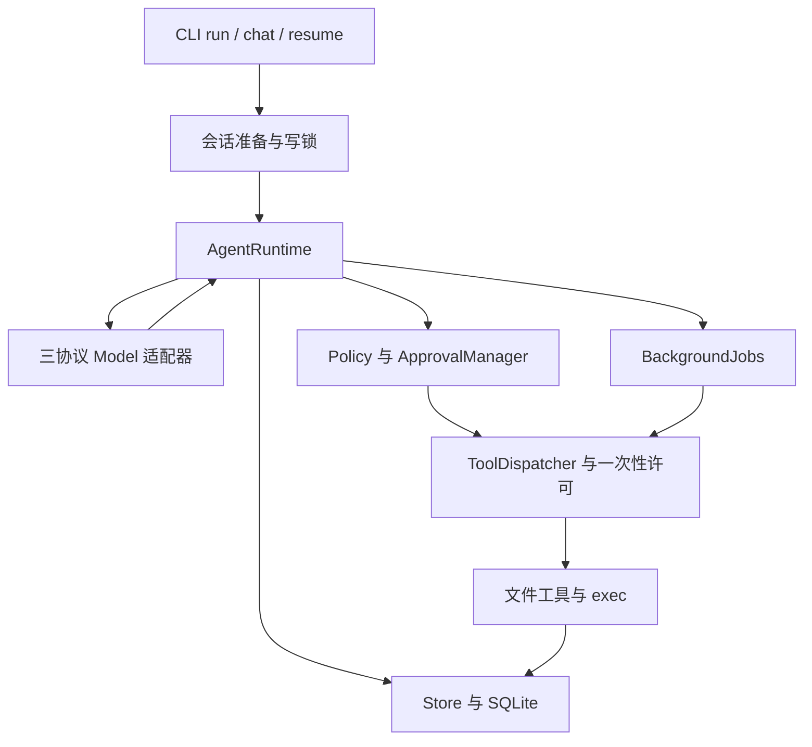

# 2026-11-07 风险优先审查

## 基线与范围

审查从干净的 `main` 提交 `1f223cb479b8fe21383aafd285114ba537d98f3f` 开始。主机为 macOS 27.2 ARM，Rust 1.99.1。原有 `./scripts/check.sh` 通过，包含 337 个测试。以下问题均用临时工作区、合成凭据和本地模型替身复现，修复遵循已确认的 B-07、B-10、B-14、B-15 和 B-21。

审查覆盖权限和模式、前后台工具入口、执行前后保存、取消和进程组清理、SQLite 恢复／锁／迁移、三协议流与历史回传、凭据和项目上下文，以及候选产物的来源和测试对象。发行状态继续以[候选验证记录](release-validation.md)为准。

## 架构路径

前台与后台子操作复用调度器和许可检查。后台启动使用内部子调用 ID 保存真实工具的意图与结果，模型原调用用启动结果闭合。模型适配器负责协议映射，运行时负责预算、调用顺序与终止。CLI 负责启动参数、控制终端和机器输出。

## 已复现并修复的问题

| 编号 | 优先级 | 影响 | 修复入口 |
| --- | --- | --- | --- |
| R-01 | P1 | 恢复 WORK 会话时，显式 `--mode plan` 被忽略，auto／bypass 下写入实际发生 | [session.rs](../crates/saya-cli/src/session.rs)、[main.rs](../crates/saya-cli/src/main.rs) |
| R-02 | P1 | 嵌套 JSON 中转义过的已知凭据进入独立核查请求，确认请求也保留相同内容 | [review.rs](../crates/saya-core/src/review.rs)、[approvals.rs](../crates/saya-core/src/approvals.rs) |
| R-03 | P2 | 用户配置 `write_max_bytes = 8` 后，9 字节的写入仍成功 | [runtime.rs](../crates/saya-core/src/runtime.rs)、[dispatch.rs](../crates/saya-core/src/dispatch.rs) |
| R-04 | P2 | Responses 在工具调用之后返回助手文字时，下一轮历史映射失败，工具可能已经完成 | [responses.rs](../crates/saya-core/src/provider/responses.rs) |
| R-05 | P2 | 无效后台子工具名或参数使运行直接失败，模型无法根据工具错误修正请求 | [runtime.rs](../crates/saya-core/src/runtime.rs) |

### R-01 恢复时的显式模式

旧实现只向恢复函数传递工作区和 profile 是否显式指定，随后直接使用保存的工作模式。新增回归先建立 WORK 会话，再执行 `--mode plan run --session ID`。修复前观察到文件实际创建，三种权限下的有效模式也与请求不符。

恢复现在传递显式模式，在打开可写数据库前使用有效模式检查 PLAN 存储目录边界，并在会话锁内保存模式。未提供模式参数时继续使用历史模式。两个入口 `run --session` 和 `resume` 使用相同逻辑。

回归包括 [CLI 测试](../crates/saya-cli/tests/cli.rs) 的 `explicit_plan_override_on_resumed_run_prevents_writes_and_is_saved`、`resuming_plan_checks_workspace_before_creating_sqlite_side_files`，以及 [交互测试](../crates/saya-cli/tests/chat.rs) 的 `resume_waits_for_input_and_uses_original_mode_with_new_permissions`。

### R-02 核查与确认的凭据边界

旧核查器和确认管理器使用局部的普通字符串替换。将含引号和反斜杠的合成凭据放进嵌套 JSON 环境参数后，字符串中的转义形式未命中普通子串判断。修复前，记录请求的模型替身收到了该数据。确认请求的参数和操作摘要也存在相同遗漏。

核查器现在对序列化后的规范化参数使用共享凭据检测，发现敏感操作即转人工确认。用户目标摘要、模型核查原因和确认展示复用共享递归脱敏。若无法安全脱敏，返回明确错误或转人工。第一次独立复核发现共享组件原有的六种转义形式上限和跳过嵌套 JSON 解码仍会泄露较深编码及 Unicode 转义形式。后续探针还复现重复键覆盖和数值表示范围造成的漏检。追加修复按实际文本长度生成转义形式，递归解码嵌套 JSON，在丢弃重复键前拒绝歧义，并对解析上限及有损数字重编码失败关闭。测试覆盖十二层组件脱敏、十层核查拦截、Unicode 转义、重复键、数值保真、无秘密内容保真、目标摘要、核查原因和确认请求。已知凭据识别范围继续受[配置与凭据契约](mvp-baseline.md)约束。

回归包括 [核查测试](../crates/saya-core/tests/review.rs) 的 `encoded_credentials_in_arguments_never_reach_the_review_model` 和 [授权测试](../crates/saya-core/tests/approvals.rs) 的 `persisted_confirmation_redacts_known_secrets_and_does_not_store_grants`。

### R-03 用户配置的写入上限

CLI 读取了 `limits.write_max_bytes`，但调度器构建写入／补丁适配器时始终使用 1 MiB 常量。修复后上限由 CLI 传到 `RuntimeLimits` 和运行共享的调度器，再传给前台与后台所使用的写入／补丁适配器。默认值仍为 1 MiB，零值拒绝。

回归为 [CLI 测试](../crates/saya-cli/tests/cli.rs) 的 `configured_write_limit_reaches_the_real_dispatcher`，通过实际 CLI 和模型工具回传验证超限结果及文件未创建。

### R-04 Responses 混合输出历史

适配器可以解析工具调用之后的助手消息，却在下一轮回传时要求所有工具结果已经出现，导致同一轮的消息被当成无效历史。修复保留 provider 输出顺序及其语义副本对应检查，工具结果仍按调用 ID 配对，并在用户消息和历史末尾检查未闭合调用。这也适用于包含此类输出的已保存会话。Responses 的本地历史管理要求保留完整且有序的模型输出。[OpenAI SDK 说明](https://github.com/openai/openai-node/blob/main/docs/responses.md)

回归为 [Responses 测试](../crates/saya-core/tests/responses.rs) 的 `multiple_function_calls_preserve_order_and_each_call_id`，覆盖调用、助手文字、另一调用以及两条结果的往返。

### R-05 无效后台请求的失败传播

后台入口原先直接向运行循环传播参数校验错误，前台则返回结构化工具错误。修复统一分类未知工具、无效参数、路径／授权失效和找不到可执行文件的错误，后台启动调用据此闭合并允许模型继续。存储错误、取消和预算耗尽仍由运行循环处理。

第一次独立复核还发现不存在或指向普通文件的命令 cwd 被标为 `io_error`，从而终止运行并将未派发的后台操作闭合为 `outcome_unknown`。追加修复在命令参数预检处明确处理不存在目录、普通文件、超长名称、符号链接循环和 NUL，其他 I/O 故障继续沿原错误边界传播。实际 CLI 回归还覆盖默认项目上下文加载，确定无效的目标保留根指令后交给工具参数校验，避免在作用域发现阶段提前终止运行。

回归为 [运行时测试](../crates/saya-core/tests/runtime.rs) 的 `invalid_tool_requests_return_paired_errors_and_allow_model_correction`，覆盖前后台十种无效请求、一次结果配对及后续模型调用。

## 验证与复核

- 最终修复的 `./scripts/check.sh` 通过，包括 fmt、Clippy `-D warnings`、342 个测试和 release 构建。发行工具的两组 Python 测试、实际 release 程序上的[五项审查回归](../scripts/release/review_regressions.py)与 `git diff --check` 通过。
- 已复读权限、许可绑定、前后台派发、模式失效和恢复路径，并运行原有授权矩阵、取消、结果保存故障、锁和迁移测试。未在这些路径新增确认的错误重复执行或数据损坏发现。
- 用户授权的子 Agent 已完成只读独立复核及追加探针，五项修复在核验范围内均通过。末次分组执行的 137 项现有聚焦测试通过，独立探针覆盖 64 项敏感输入、21 项安全指纹文本，以及启用根／子目录指令的 20 项前后台路径用例。核查模型对敏感探针的调用数均为零。路径错误均能返回结果并继续修正。
- 已从 `854be1b` 导出源码并重新构建四目标候选，四个解包二进制均通过 smoke、交互流程和五项审查回归。包与二进制哈希、构建环境及测试脚本哈希见[发行记录](release-validation.md)。最终候选仍需 macOS 15 双架构实际执行证据。较早 CI 和旧包的结果按各自源码及二进制分别记录。

## 保留的发行限制

发行说明继续保留当前没有 OS 沙箱、进程组无法约束主动脱离的后代、外部并发文件替换缺少原子 CAS，以及强制终止后的后台进程状态可能未知等限制。Sandbox、MCP、自动 compact 和插件系统按后续规划管理。[候选版本说明](release-notes-0.1.0.md)

已知凭据保护采用失败关闭，重复键、过深嵌套及无法安全解析或保真重编码的数值可能使部分无秘密内容也被拒绝。[存储边界](storage.md)
