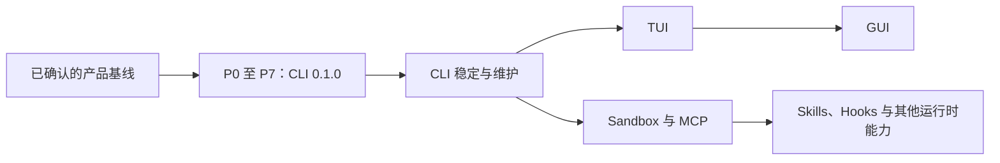

# MVP 实施路线图

**原计划制订于 2026-11-06。P0 至 P7 已完成，0.1.0 已发布，本文保留 MVP 阶段与验收定义。**

本计划细化已确认的[完整基线](mvp-baseline.md) B-01 至 B-24，遵循 D-027，不改变产品范围或接口。任务定义见[实施任务](implementation-plan.md)，唯一进度记录见[开发进度](progress.md)。计划不是实现或发布完成的证据。

后续能力全景见[能力路线图](capability-roadmap.md)，下一阶段任务、候选版本及依赖见[后续开发计划](post-mvp-plan.md)。

## 当前起点

- 已完成：需求、模式、权限、执行、存储、工程与验收基线的文档定案。
- 已补齐：根目录 MIT 许可证与最小 .gitignore；工程阶段复用既有文件。
- 已建立最小 Rust workspace、本地检查入口和 CI 配置；P6 四平台 CI 和指定模型的三协议小规模联调已通过；四原生目标最低环境候选验收已完成。
- 0.1.0 的完成证据见[发行验证](release-validation.md)，新增功能按后续开发计划选择任务。

## 版本路线

CLI 0.1.0 的范围已确定。CLI 稳定后，界面线按 TUI → GUI 演进，运行时能力线按后续能力路线图推进；两条线按依赖安排，不要求运行时扩展等到 GUI 完成。后续新增功能在各自阶段形成设计，不加入当前 MVP。

## CLI MVP 的八个里程碑

下表默认按顺序推进。每阶段达到退出条件后，再把下一阶段列为当前工作；具体任务的最小依赖见实施任务文档。

| 阶段 | 目标 | 主要交付 | 退出条件 |
| --- | --- | --- | --- |
| P0 工程基础 | 建立可检查的最小 workspace | Rust 1.99.1／2024、core＋CLI、Cargo.lock、MIT、基础 CI 与测试夹具目录 | 两个 crate 可构建，工具链与检查可重复运行 |
| P1 运行时闭环 | 在假模型上证明核心循环 | 核心类型、事件／结果契约、串行循环、内存存储接口、工作模式、取消与预算 | 直接回答、工具回传、切换、取消、限额与失败具有确定结果 |
| P2 工具与权限 | 落实真实工具边界 | 七个本地工具、三权限模式、规则引擎、核查替身、确认与预授权 | 12 种模式组合、PLAN 只读、路径、拒绝、超时和许可失效验证通过 |
| P3 三协议接入 | 独立适配模型接口 | HTTP／SSE、Chat Completions、Responses、Anthropic、真实核查请求适配 | 三协议各自通过离线流式、工具、错误和上下文往返夹具 |
| P4 CLI 与交互 | 从终端使用公共运行时 | TOML／环境／参数、run／chat／config、REPL、ask_user、用户级／工作区指令与 Skills 发现 | 连续对话、单次执行、人工确认、无终端、指令路径与 Skills 发现通过验证 |
| P5 持久化与恢复 | 使副作用与会话记录一致 | SQLite WAL、执行前后保存、list／show／resume、写锁、迁移与故障处理 | unknown、崩溃、悬空工具、历史授权、配置变更与保存失败验证通过 |
| P6 集成与完整验收 | 补齐对外输出与四类任务 | JSON／JSONL、日志脱敏、用量、四个任务夹具、真实使用文档 | AC-01 至 AC-23 有自动化或明确的验证证据，无占位功能 |
| P7 发布准备 | 证明首版具备交付条件 | 三协议人工联调、四平台构建／smoke、校验和、版本说明与验收报告 | AC-24 与全部发行条件满足，产物标注与验证范围一致 |

P0、P1 的 CLI 可以只有构建／帮助入口，不宣称任务执行已可用。P2 至 P4 的工具验证使用临时夹具与可故障注入的内存存储；持久化尚未接入时，普通 CLI 不开放真实工作区的副作用执行，相关路径只在受控测试入口验证。真实工作区完整验收须接入 P5。P7 准备产物与发布材料，外部发布仍按已有用户指令边界执行。

## 实施中的依赖安排

- P1 先定义存储边界与副作用前保存钩子；P2 不等待 SQLite 就能测试“保存意图失败时工具不能执行”，P5 再接入真实事务。
- 事件、结果、配置与工具契约从开始就遵守 schema v1；P6 是完整序列化与端到端验收阶段，不是临时决定字段的阶段。
- 三个协议在 P3 各自实现和验证，共用传输基础；不以任一协议成功代替其他协议的验证。
- 核查请求在 P2 用替身验证判断链，P3 接通已选 profile；凭据脱敏从接入 HTTP 时落实，P6 验证整个路径。
- P4 的终端交互只做界面适配，确认、切换、取消和预算由 core 处理，为 TUI／GUI 复用留下清楚边界。
- 早期 CI 提供持续反馈，P7 完成发行平台与最低环境验证，不把“CI 原生构建成功”直接当作四个平台全部受支持。

## 工作量与排期方式

以下是初始工作量估算，假设一位开发者配合 AI、以串行集成为主；单位为专注工程工作日，包含适用测试与文档，不是发布日期承诺。T0 是实际实现开始日。

| 阶段 | 初始估算 |
| --- | --- |
| P0 | 1–2 日 |
| P1 | 3–5 日 |
| P2 | 5–8 日 |
| P3 | 5–8 日 |
| P4 | 3–5 日 |
| P5 | 5–8 日 |
| P6 | 3–5 日 |
| P7 | 3–5 日 |
| 合计 | 28–46 日，约 6–10 个工作周 |

等待账户配置、外部服务、评审与发行平台环境的时间单独记录。完成 P1 后，用实际耗时、剩余问题和验证成本更新估算；不通过减少三协议、权限或恢复验收来维持原估算。TUI／GUI 在核心完成并取得使用反馈后单独估算。

## 每个任务的完成标准

1. 任务范围内行为已经实现，引用的基线和验收条件能对应到代码。
2. 适用的 fmt、Clippy、测试和构建检查通过，或明确记录实际阻碍；有阻碍的任务不标记完成。
3. 配置、公共接口、示例和说明同步；未验证的平台或模型不写成已支持。
4. 在进度记录中填入证据：文件／变更定位、执行命令、结果摘要与必要的报告路径。
5. 阶段退出条件满足；后续工作无需依赖未说明的占位实现或人工绕过。

任务可以拆成多个聚焦变更；提交信息继续遵循 Conventional Commits。是否创建实际提交、推送与发布由当前用户指令决定。

## CLI 0.1.0 的发行条件

- 24 组基线均有实现／验证对应，AC-01 至 AC-24 全部具备证据。
- 没有已知的 PLAN 越界、显式 deny 失效、历史授权复活、工具自动重跑或会话静默损坏问题。
- 三协议人工联调记录明确模型、协议版本、日期、任务与结果；没有测试账户时记录阻碍，不用离线替身冒充真实联调。
- Linux glibc 2.35 与 macOS 15 基线、x86_64／aarch64 的构建和 smoke 范围明确；未验证的目标不能作为已验证发行目标宣传。
- 从干净环境完成配置、首次运行、权限确认、退出、列出、恢复及继续输入的演练。
- 版本说明包含支持范围、已知限制、迁移说明、产物校验和与配置文档；源码中的实际许可证与依赖信息齐全。

## 后续阶段

### CLI 稳定与维护

目标是让首版能够持续使用：处理真实错误报告、完善诊断和恢复说明、回归协议变化、维护依赖与发行流程。每个修复附可复现用例，继续保持 schema 与数据库兼容。该阶段可以在后续界面开发期间持续进行。

### TUI

进入条件是 CLI 的执行、权限、事件与恢复已稳定。规划交付包括会话选择、对话与工具过程展示、当前／待切换模式、确认与澄清、取消和结果查看。TUI 通过 core 的同一输入／事件／控制接口工作，不能自建另一套权限或执行循环。

开始时完成一份界面流程与框架验证；验收应复用四类任务与权限矩阵，并覆盖终端尺寸变化、键盘操作、退出清理和恢复。实际版本号、界面框架和新增范围在该阶段设计中记录，不影响 0.1 基线。

### GUI

在 TUI 对核心接口的复用得到验证后，规划桌面会话、任务输入、执行过程、确认、产物和设置界面。先验证本地 core 桥接与生命周期，再处理打包和平台分发，防止界面退出后仍有失控任务运行。

GUI 的新增交互、可访问性、目录选择、权限呈现和升级迁移单独验收，继续复用已确认的运行时行为。新平台支持需新增目标与验证证据。

### 运行时后续能力

[能力路线图](capability-roadmap.md)已扩展为 F-01 至 F-20。近期候选包括共享应用服务、增强日志、Session Export 和默认 TUI，隔离、MCP、检查点、Compact、插件及 Goal 按依赖推进。具体任务与验收见[后续开发计划](post-mvp-plan.md)，跨运行持久调度及多 Agent 在对应后续阶段交付。

## 下一步工作入口

P0 至 P7 已完成实现与验收；0.1.0 发行构建后进入 CLI 稳定维护及后续能力开发。实际状态和验证范围以[开发进度](progress.md)为准。
