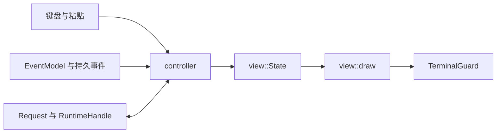

# TUI 界面设计与改进入口

**更新于2026-11-09。本文对应DEV-048至DEV-050及开发线的布局、运行反馈与结束统计，实际绘制函数为 `view::draw`。默认入口和各源码的验收状态见[开发进度](progress.md)。**

Saya 的终端界面以持续对话为主。用户在主区查看回答与工具进度，在同一窗口编辑下一条消息，通过详情区检查操作参数、确认请求和已保存结果。

## 布局

界面按终端单元格分配空间，所有尺寸采用同一参考样式。

| 区域 | 内容 | 当前尺寸 |
| --- | --- | --- |
| 顶栏 | Saya Harness、版本、Ctrl+P命令入口 | 1行 |
| 外框顶边 | 工作目录 | 1行 |
| 主区 | 对话与按需详情 | 占据剩余高度 |
| 状态行 | Ready／运行状态、忙碌动画，右侧为权限 | 1行，空间充足时动画占8列 |
| 输入区 | 灰底、三分之一宽模式色条、多行草稿和光标 | 通常4至6行，右侧留1列主区底色，极小窗口按可用空间压缩 |
| 外框底边 | 模式、模型、effort和输入占比 | 1行 |
| 宽屏侧栏 | 会话名、上下文分项、扩展状态和其他元数据 | 达到120列×24行时显示，宽度为窗口四分之一，限制28至40列 |

主区没有详情时，对话使用全部主区宽度。主区宽度达到100列时普通详情与对话并列，详情宽度取主区的三分之一，并限制在32至48列；较窄时普通详情占据主区。审批、澄清和`/ps`当前Run后台任务使用对话主体内的居中圆角弹窗，保留底部草稿输入且不覆盖会话外框。所有尺寸保留同一主区外框，低于20列或6行时提示放大终端。

长模型名先截短，为effort与用量留空间，极窄窗口优先模式和用量。有详情且高度很小时，至少保留一行可滚动的实际详情，压缩输入为无标题的单行草稿。翻页步长依据实际详情高度，便于逐行查看工具、调用ID和参数。

```text
单主区
Saya Harness (v实际版本)                       Ctrl+P commands
┌ • /workspace ────────────────────────────────────────────┐
│                                                         │
│ 对话，或按需显示审批／工具详情                             │
│                                                         │
│ ✓ Ready                                            auto │
│ 🯏 Message                                               │
│ 🯏 draft                                                 │
│ 🯏                                                       │
└ WORK model max                 ◔ input 25.6k/128k (20%) ─┘

宽屏侧栏
Saya Harness (v实际版本)      Ctrl+P commands  会话概括名
┌ • /workspace ────────────────────────────┐ Context · Estimated
│                                         │ Window 128k
│ 对话，或按需显示审批／工具详情             │ System       ███ ~4k
│                                         │ Instructions █   ~1k
│                                         │ Skills       █  ~300
│                                         │ …
│                                         │ Extensions
│                                         │ MCP No servers
│                                         │ Plugins Not implemented
│ ✓ Ready                            auto │ Skills N discovered
│ 🯏 Message                               │ Profile
│ 🯏 draft                                 │ 其他会话元数据
└ WORK model max      ◔ input … ───────────┘ /workspace
```

上图表达区域关系，实际字符布局可由下方预览命令生成。布局代码集中在[view.rs](../crates/saya-tui/src/view.rs)。

## 配色与信息层级

在参考布局上采用低对比表面和层次色，主区为近黑色，侧栏和输入区依次提升亮度，边框保持暗色。Ready为绿色，等待输入／批准为暖色，失败为红色，thinking effort为橙黄色。界面标签使用英语。

| Token | RGB | 使用位置 |
| --- | --- | --- |
| Background | `#09090B` | 主区底色 |
| Sidebar | `#141416` | 侧栏底色 |
| Input | `#202024` | 输入区底色 |
| Input border | `#2A2A30` | 输入区底部留白内的浅收边 |
| Border | `#303038` | 低对比外框和分隔 |
| Foreground | `#D4D4D8` | 消息正文与主要元数据 |
| Strong foreground | `#E8E8ED` | 品牌、分区标题、非零数值与输入标题 |
| Muted | `#81818B` | 次要元数据和流式状态 |
| Blue | `#58A6FF` | WORK模式、用户来源与运行状态 |
| Heading | `#BB9AF7` | 正文标题 |
| Inline code / Ready | `#7DCB9B` | 行内代码和就绪状态 |
| Amber | `#F6AD55` | 强调、列表标记、effort及等待状态 |
| Soft amber | `#BBA685` | Manual Approval与bypass权限标签 |
| Code background | `#17171B` | 代码卡片背景 |
| Code foreground | `#C4C4CC` | 代码正文 |
| Red | `#F87171` | 失败状态 |

### 四模式颜色

输入框色条与底栏当前模式文字共用 `mode_color` 映射，取当前实际生效的 `State.mode`。

| 工作模式 | 配色 | RGB |
| --- | --- | --- |
| WORK | 晴蓝 | `#58A6FF` |
| CODE | 薄荷绿 | `#7DCB9B` |
| PLAN | 薰衣草紫 | `#BB9AF7` |
| BUILD | 暖杏橙 | `#F6AD55` |

空闲时Tab切换完成后，两处同步换色。运行中底栏分别以当前模式色和目标模式色显示 `WORK→CODE` 等待切换文字，箭头采用Muted；输入色条在实际模式于调用边界生效后更新。未知模式显示Muted。底栏模型名称使用正文前景，effort和用量采用各自信息样式。

输入色条使用 `🯏`（U+1FBCF，LEFT ONE THIRD BLOCK），以模式前景色覆盖单元格左侧三分之一，其余部分采用输入区灰底。保留原单列占位、左内边距和文字起点，右侧增加一列主区底色，使灰色Message区域与外框／侧栏之间保有间距。字符绘制依赖终端字体的对应字形。[Unicode字符表](https://www.unicode.org/charts/PDF/Unicode-17.0/U170-1FB00.pdf)

消息标题标明用户、模型、工具和系统来源，主标题采用较亮前景和字重，流式与截断标记分层着色。消息间留空行，较宽正文两侧各增加一格留白，极窄窗口使用可用宽度。工具结果采用低对比摘要卡片，展开查看安全原文。审批与澄清显示安全处理后的原始参数。

Assistant正文支持有界的基础Markdown呈现，包括ATX标题、无序／有序列表、引用、成对强调、行内代码以及代码围栏。标题使用紫色，强调和列表标记使用暖色，行内代码使用绿色，代码围栏转换为带语言标签的卡片。流式未闭合的行内标记保留可见文本，代码内部保持原文，URL／HTML展示为可见文本且不触发链接动作。每逻辑行至多256个样式片段，嵌套上限为4，折行按完整grapheme处理并沿用10,000视觉行缓存预算。

共享颜色定义在[theme.rs](../crates/saya-tui/src/theme.rs)，正文样式与折行在[rich_text.rs](../crates/saya-tui/src/rich_text.rs)，区域绘制在[view.rs](../crates/saya-tui/src/view.rs)。

侧栏分区标题配浅色分隔，非零用量数字与零值使用不同灰度，任务进行中高亮，完成项弱化。状态行的权限标签按实际权限区分颜色。

输入区以Strong前景和字重强调Message标题，发送、换行和折叠快捷键采用深底键帽与弱化说明文字。常规空输入在编辑首行显示斜体 `Describe a task…`，占位文字仅参与渲染，发送和Tab模式判断读取Editor草稿。人工审批、澄清、截断和补全场景采用各自提示。原底部留白内增加低对比细线，实际草稿区保留多行编辑与水平跟随。1至2行的极小输入区按空间简化提示，粘贴超限使用暖色加粗警示。

粘贴或拖入本地文件时，草稿显示 `[Image N]`、`[Audio N]`、`[Video N]` 或 `File: [File N]`，按媒体类型使用不同加粗高亮。文件引用作为Editor中的原子token参与移动、删除、换行和裁剪；左右键跨过整个token，任一边界删除都移除完整附件。模型输入保留链接形式的真实路径，会话恢复与窗口标题只显示token。图片、音频和视频是否转为原生content part由profile能力决定，普通File继续提供路径。`Ctrl+V`支持直接读取剪贴板图片二进制，保存到`~/.saya/paste_image/`后插入Image token。

## 运行反馈与结束统计

任务运行时，状态文字后的八列区域内显示一个模式色方块。方块从最右侧逐格移动到最左侧，再折返回右侧，每120ms推进一帧，14帧完成一次往返。Ready、Running、Thinking、Responding、Reviewing和Cancelling以实际运行状态决定是否播放；等待人工批准／输入及结束时隐藏。窄窗口优先保留状态与权限标签，动画按可用空间显示。颜色跟随实际生效模式。

主方块 `█` 后保留最近三帧的轨迹，依次用 `▓`、`▒`、`░` 表示衰减粒子，并以DIM弱化模式色。启动时按实际经过的帧生成拖尾，折返重叠时较新的粒子覆盖旧粒子，主方块最后绘制。完整轨迹保留在八列动画区域内。

每次任务结束后，在本次回答和工具记录下方追加一行界面统计，成功、取消、达到限制及失败均有对应收尾。模式标签使用该次任务实际结束模式的颜色，其余字段采用Muted，长行按终端宽度换行。

```text
CODE · configured-model · 1m 19s · 143.5 tok/s · 12.3k tokens
```

| 字段 | 统计口径 |
| --- | --- |
| Mode | 任务结束时实际生效的工作模式，后续切换保留该条记录原来的配色 |
| Model Name | 启动该次任务的执行模型名称 |
| Usage Time | 从启动运行至界面完成收尾的单调时间，包含模型、工具、人工等待和清理 |
| Token per sec | Execution模型输出token之和除以其生产侧ModelStarted至ModelFinished事件发布间隔之和，包含请求／首token等待、流处理和提交／派发开销 |
| Total Token Usage | 最终RunResult的总输入token加总输出token，包含执行与核查调用 |

模型速率使用事件发布端的单调时间，分母为Execution请求区间之和，显示其平均输出吞吐。缺失、未闭合、无法配对或溢出的统计显示 `—`，估算值带 `~`，总量使用k／M／G缩写。精确的原始用量继续由运行记录提供。

结束统计作为当前TUI运行中的显示消息保留。会话恢复读取已保存的对话和执行记录，模型区间时长属于本轮界面采样。统计文本经过当前凭据集合脱敏和单行控制字符处理，再进入有界显示队列。

使用以下debug预览查看布局与动画。completed场景中的数字明确标为合成预览数据。

```sh
just tui-preview working
just tui-preview completed
just render-preview 160 45 completed --json
```

## 编辑与滚动

输入以 UTF-8 保存，左右移动和删除使用 grapheme 边界，支持组合字符及 emoji 序列。上下移动按显示列定位。长输入行水平跟随光标，多行草稿在输入区内垂直跟随光标，Tab 展示为四个单元格。

| 操作 | 编辑／呈现行为 |
| --- | --- |
| Enter | 发送消息、执行斜杠命令，或回复当前澄清 |
| Alt+Enter 或 Ctrl+J | 插入换行 |
| 左／右 | 移动一个 grapheme |
| 上／下 | 移动到相邻逻辑行 |
| Home／End | 当前输入行首／行尾，正在浏览对话历史时 End 先恢复跟随输出 |
| Backspace／Delete | 删除前一个／后一个 grapheme |
| 粘贴 | 在光标位置插入，达到输入限额时保留 UTF-8 前缀并显示标记 |
| PgUp／PgDown | 详情按可见高度翻页，每次最多10行，对话每次10行 |
| Ctrl+P | 打开／关闭居中命令浮层，方向键选择，Enter执行高亮项，Esc返回 |
| `/`前缀 | 单行且光标在末尾时显示匹配命令与灰色建议后缀 |
| ↑／↓ | 建议可见时循环选择候选 |
| Tab／末尾→ | 将选中的建议填入草稿，Enter执行完整输入 |
| 空输入按Tab | 按WORK→CODE→PLAN→BUILD→WORK循环工作模式 |
| 点击折叠标题 | 展开／收起对应Thinking或长工具卡片 |
| 左键拖选 | 高亮对话区或工具／审批详情中的可见文字 |
| Ctrl+O | 展开／收起最近保留的Thinking或长工具卡片 |
| 鼠标滚轮 | 在指针所在对话／详情区域滚动，每次3行 |
| Ctrl+C | 有拖选区时发送复制请求，其他情况请求取消当前运行及UI任务，空闲时清空草稿 |
| Ctrl+D | 输入为空时请求退出，运行中的任务先取消并收尾 |
| Esc | 清除选区，或隐藏可见建议，再处理详情或当前等待的审批／问题 |

对话滚动量表示距底部的视觉行数，0代表跟随新输出。浏览历史时，新行到达会调整滚动量，保持当前内容的位置。详情滚动量从顶部计数，切换详情时由 controller 归零。

拖选按渲染后的可见单元格取字，支持正向／反向跨行选择、中文宽字和组合字符。复制时裁去各视觉行尾的空白，再以换行连接。松开鼠标保留高亮，Ctrl+C发送复制请求并清除选区，输入草稿保持可编辑。没有拖动的点击在松开时触发折叠或脚注。滚动、缩放和所选内容变化会清除选区，状态动画和选区外追加时可保留当前选区。可选区域为对话与工具／审批详情，输入框使用原有编辑操作。

复制通过OSC52将UTF-8文本以Base64发送给终端，支持该协议且允许剪贴板操作的终端将其写入系统剪贴板。最终复制限额为64KiB，超过限额时界面提示错误。正常TUI与debug预览共用鼠标选区和复制逻辑。[xterm控制序列说明](https://invisible-island.net/xterm/ctlseqs/ctlseqs.html)

空输入Tab要求草稿为空且命令面板关闭，已有空格、多行或其他文本时沿常规编辑／补全处理。运行中从最近一次待切换选择继续循环，由core在调用边界应用。等待UI任务清理时按最新排队模式选择下一项。切换复用模式命令的根目录、持久化与审批失效处理，权限模式独立。空输入循环以模式状态提供反馈，普通切换过程不新增对话消息。

人工审批要求当前详情可见。输入为空时，新的普通／Shift `y` 批准，`n` 或 Esc 拒绝。重复按键与 Ctrl／Alt／Super 组合键不会提交审批。澄清使用输入框回复，`//` 开头可以发送字面量斜杠。待审批时也能输入 `/mode MODE`，旧回复随切换请求失效。

输入编辑规则集中在[editor.rs](../crates/saya-tui/src/editor.rs)，全局快捷键在[controller.rs](../crates/saya-tui/src/controller.rs)，命令与人工输入接线在[controls.rs](../crates/saya-tui/src/controller/controls.rs)。

斜杠补全的静态目录和筛选状态位于[commands.rs](../crates/saya-tui/src/commands.rs)。24项候选与命令面板、帮助共用，包含固定参数及带末尾空格的参数前缀。`State.completion`保存选择与隐藏状态，灰色建议只参与绘制。弹层标题为 `Command suggestions`，位于输入框上方，最多6行，选中行使用 `›`与高亮，剩余宽度显示说明。20×6保留输入行、光标与底栏，弹层按空间降级。

Esc先隐藏可见建议并保留草稿，再沿普通详情／审批优先级处理。Tab可重新接受已隐藏建议，输入前缀变化会重置选择。补全仅匹配末尾光标的单行 `/`输入，`//`和多行文本使用常规编辑。输入框中需要用户填写的profile名、会话／任务ID和路径跟在补全保留的空格之后。

## Thinking与任务清单

Thinking与工具长输出使用可折叠卡片，命中区域按本帧实际可见标题记录。消息正文中的相似标题文本不产生点击动作。卡片展开状态绑定稳定消息ID，消息移除时清理。弹层拦截其覆盖位置，缩放后重新生成命中区域。

执行轮次按ModelStarted事件顺序显示Thinking，watch日志更新已存在的卡片。可读推理在应用层独立投影、完整脱敏后截断，日志最多64轮／合计2MiB，每轮显示最多256KiB。原始聚合超过16MiB时仅保留受限提示，执行继续遵守原有预算。内容不可用时显示实际状态。

Tasks使用core的TodoItem类型，最多64条。侧栏用○／◐／✓标记pending／in_progress／completed，任务正文保留为安全单行，长项按可用宽度截短，条目超出可见区时显示余项数量。列表来自成功工具结果，恢复时从历史重建。

完整结构化工具结果经严格的本地投影生成标题摘要。任务列表显示总数、完成数和进行中数，文件读取显示行范围与字节数，搜索／目录显示项数，命令显示实际argv、观测耗时、退出码及取消／超时状态。错误摘要取实际code与message，截断以暖色标记。正文、stdout与命中内容通过展开查看，分组标题使用强调色，值按层级缩进；内部命令分析字段不显示。摘要输入和单行输出均有界，未知或不完整结构沿安全原文显示。

## 显示预算与安全呈现

| 数据 | 当前显示限制 |
| --- | --- |
| 输入草稿 | 64 KiB |
| 单个可选区域快照 | 最多32,768单元格、64KiB文本 |
| 剪贴板复制文本 | 最多64KiB，包含视觉换行 |
| 单条消息正文 | 256 KiB |
| 消息缓存 | 合计2 MiB，最多512条 |
| 对话折行缓存 | 最近10,000视觉行 |
| 详情缓存 | 最多2 MiB、10,000逻辑行，标题最多256字节 |
| 详情折行缓存 | 前10,000视觉行 |

对话移除较早的显示内容时带省略标记。详情达到上限时，标题前部显示 `Truncated`，末尾带截断说明。控制字符、C1控制字符与双向覆盖字符转成可见文本。工作区、profile、model 和状态等单行元数据也会处理换行。

controller 在写入显示状态前应用当前配置的已知凭据脱敏。工具／后台快照与会话列表在阻塞工作线程中完成结构投影、脱敏和详情预算处理，最终标题及元数据行也经过脱敏。`State::set_details` 统一约束详情保留量，绘制入口再次规范化外部直接赋值。消息、工具参数和结果继续由运行时及持久层保存其来源，视图缓存按上表限制显示数据。完整的存储、导出与凭据范围见[会话导出](session-export.md)。

## 模式、审批与工具信息的来源



| 信息 | 来源与界面责任 |
| --- | --- |
| 工作模式 | Config 提供启动选择，RuntimeHandle 提供当前和待生效模式；State 同时保存两者 |
| 权限模式 | 当前运行配置与用户操作，由 controller 写入状态行右侧 |
| Thinking effort | 所选执行 profile 的实际请求设置，未配置显示 `—`，协议字段见[配置](configuration.md#thinking-effort) |
| 输入用量 | 最近一次执行请求的 `ModelFinished.usage.input_tokens` 与配置窗口之比，估算带 `~`，未知显示 `—` |
| 结束统计 | 最终RunResult用量与当前任务的单调时间采样，模型区间由TUI的事件发布端观察 |
| 忙碌动画 | 当前运行、状态与120ms显示帧，颜色使用实际模式映射 |
| 窗口标题 | 从会话首条用户任务派生、脱敏、合并空白、保留80字符，经 TerminalGuard 清理后写入 OSC 2 |
| 人工审批 | `saya-app::interaction::Request::Approval` 提供操作、参数与原始回复通道，详情区呈现经过脱敏的内容 |
| 用户澄清 | `Request::Input` 提供问题及可选建议，输入区承接回复 |
| 模型文本 | `ModelTextDelta` 合并到稳定消息 ID，最终结果可校正可见正文 |
| 工具进度 | `ToolStarted`／`ToolFinished` 与持久记录提供调用 ID、状态及结果 |
| 运行结束 | RunResult 提供最终状态、错误与可用用量 |
| 会话和导出 | 已建立的 app／core 会话与导出服务提供持久数据 |

工作模式与权限规则由 core 执行。人工回复沿原请求通道返回，失效与版本检查由运行时落实。底栏在切换等待期间保留当前模式，并展示待生效模式。UI 查询或导出仍在收尾时，模式请求先排队；core 已有待生效模式时，导出等待模式稳定后由用户重新发起。数据契约见[TUI 总体设计](tui.md)。

## 当前命令与服务行为

命令面板通过 `State.command_palette` 保存选中项，绘制在整帧最后一层。圆角弹层宽度为终端宽度减2列并限制在88列，高度为终端高度并限制在14行，居中呈现。常规窗口显示11项候选及底部导航，右上角标记选择计数。较窄时隐藏说明文字，20×6显示3项及Esc关闭提示，并清理两侧背景残字。

`palette_first`记录有界可见窗口，选择落在窗口内时保持起始行，越界与缩放时重新约束。候选命中区域仅来自本帧实际绘制行，点击只选中，候选行上的滚轮每次移动一项。边框、标题、页脚和浮层外的指针事件由模态边界处理。

浮层与Details分别保存，打开／关闭保留真实详情及滚动位置，后台新到请求更新其真实内容。普通编辑键及粘贴由浮层接管，Enter执行高亮项，Esc／Ctrl+P关闭，Ctrl+C与空草稿Ctrl+D使用运行控制。带参数项填入空草稿，已有草稿时先提示处理。新按键Press约束避免关闭后的Repeat提交背景草稿。

提交时根据待处理请求的类型核对实际可见详情。审批或澄清被异步查询覆盖时，先恢复对应请求并保留草稿，等待新的按键确认。

绘制期间暂时隐藏编辑光标及斜杠建议，关闭后恢复草稿光标。背景折叠与滚动的命中方法通过模态状态统一约束，真实工具与授权仍由对应服务处理。

| 命令 | 行为与条件 |
| --- | --- |
| `/mode plan\|build\|code\|work` | 用户请求切换工作模式，实际生效遵循 core 调用边界及清理规则 |
| `/permissions auto\|manual\|bypass` | 运行与 UI 任务均空闲时修改本次权限 |
| `/status`、`/cancel` | 查看当前状态，或请求取消运行与 UI 任务 |
| `/new` | 空闲时创建新会话并等待输入 |
| `/sessions [PAGE]` | 查询已保存会话，每页20条，页码从1开始 |
| `/resume ID` | 空闲时恢复会话并等待新输入，采用本次权限 |
| `/resume-accept ID` | 显式接受可兼容的配置指纹变化后恢复，协议／模型兼容规则继续由共享服务检查 |
| `/profiles`、`/profile NAME` | 查看配置中的 profile，空闲时选择 profile，下一条消息创建新会话 |
| `/tools`、`/jobs` | 读取当前会话的一致性快照，显示水位及 `run_id`、`call_id` 等关联 |
| `/cancel-job ID` | 向当前运行请求取消其拥有的后台任务 |
| `/export json\|markdown PATH` | 导出 transcript，省略工具正文 |
| `/export-full json\|markdown PATH` | 导出 full 范围并包含工具正文 |
| `/help`、`/exit` | 查看快捷键与常用命令，或请求退出 |

工具和后台面板明确标记 UI 读取来源，按持久记录保留 `unknown`、错误和截断状态。恢复的中断响应标记为 `Assistant · interrupted partial`。后台任务的执行生命周期仍属于当前运行。

新建、恢复和快照／导出各自使用可取消的 UI 任务，同一时刻最多一个。Ctrl+C 请求取消并等待结果。导出相对路径按当前会话工作区解析，目标父目录须已存在，安全发布保护已有目标。发布提交完成后才收到取消时，界面仍报告实际发布回执。PLAN 导出路径检查沿用共享应用服务。会话与发布接线见[services.rs](../crates/saya-tui/src/controller/services.rs)。

## 从实际组件生成预览

预览程序用合成 State 调用生产 `view::draw`，经 Ratatui TestBackend 导出字符布局。场景包含用户文本、中文、工具的 `unknown` 状态、代码及可选详情，模型请求数为0。

```sh
cargo run --locked -p saya-tui --example render_preview -- 120 30
cargo run --locked -p saya-tui --example render_preview -- 120 30 approval
cargo run --locked -p saya-tui --example render_preview -- 120 30 attachments
cargo run --locked -p saya-tui --example render_preview -- 120 30 question
cargo run --locked -p saya-tui --example render_preview -- 120 30 background
cargo run --locked -p saya-tui --example render_preview -- 60 24 approval
cargo run --locked -p saya-tui --example render_preview -- 120 30 tool
cargo run --locked -p saya-tui --example render_preview -- 120 30 help
cargo run --locked -p saya-tui --example render_preview -- 120 30 commands
cargo run --locked -p saya-tui --example render_preview -- 120 30 memory
cargo run --locked -p saya-tui --example render_preview -- 120 30 skills
cargo run --locked -p saya-tui --example render_preview -- 120 30 mcps
cargo run --locked -p saya-tui --example render_preview -- 120 30 plugins
cargo run --locked -p saya-tui --example render_preview -- 120 30 sessions
cargo run --locked -p saya-tui --example render_preview -- 80 24 idle
cargo run --locked -p saya-tui --example render_preview -- 80 24 effort
cargo run --locked -p saya-tui --example render_preview -- 60 18 compact
cargo run --locked -p saya-tui --example render_preview -- 20 6 idle
cargo run --locked -p saya-tui --example render_preview -- 160 40 refined
cargo run --locked -p saya-tui --example render_preview -- 160 40 tasks
cargo run --locked -p saya-tui --example render_preview -- 160 40 folded
cargo run --locked -p saya-tui --example render_preview -- 110 36 expanded
```

文本输出保留字符布局，配色由上方 token 表描述。真实终端交互和恢复由 PTY 及候选程序验收覆盖。预览程序源码见[render_preview.rs](../crates/saya-tui/examples/render_preview.rs)。

## 改进时对应的代码

| 想调整的部分 | 修改入口 | 核对方式 |
| --- | --- | --- |
| 色彩、边框与角色层级 | view.rs 的颜色常量及 `role_style` | 宽屏与窄屏预览 |
| 顶栏信息密度 | `draw_header` 和顶部布局约束 | 不同 profile／model 名称和窄终端 |
| 主区与详情的比例 | `draw` 的100列断点及32至48列宽度 | 80、100、120及更宽终端 |
| 代码与消息形态 | `draw_transcript` 和消息标题 | 代码围栏、长行及高频增量 |
| 输入高度、光标和编辑键 | `draw_editor`、Editor 与 controller 的按键分发 | 多行中文、emoji、粘贴及长行 |
| 审批与命令面板 | controller.rs、controls.rs，Details与独立command_palette浮层 | 人工等待、过期回复、模态输入与取消 |
| 会话、工具与后台信息 | services.rs 的服务接线及详情内容 | 活跃／已恢复会话、unknown与错误 |
| 终端恢复 | terminal.rs 的 guard 与输出生命周期 | 正常退出、错误、信号及慢消费者 |

可进一步比较顶栏的紧凑程度、工具消息的折叠方式、审批操作提示的位置，以及详情在窄屏中的返回方式。每次调整后，使用同一组合成预览和正常入口用例核对呈现与交互。
