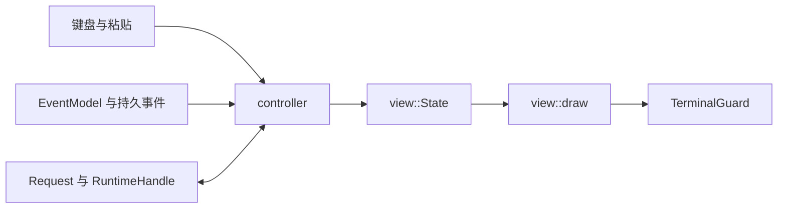

# TUI 界面设计与改进入口

**更新于 2026-11-08。本文对应 DEV-048 至 DEV-050 的实际组件与服务，实际绘制函数为 `view::draw`。默认入口和跨平台候选程序的验收状态见[开发进度](progress.md)。**

Saya 的终端界面以持续对话为主。用户在主区查看回答与工具进度，在同一窗口编辑下一条消息，通过详情区检查操作参数、确认请求和已保存结果。

## 布局

界面按终端单元格分配空间。

| 区域 | 内容 | 当前尺寸 |
| --- | --- | --- |
| 顶栏 | Saya、工作模式、权限、运行状态；工作区、profile／model；用量 | 常规3行，终端低于12行时2行 |
| 主区 | 对话与按需详情 | 占据剩余高度 |
| 输入区 | 多行草稿与插入光标 | 含边框3至8行，根据草稿与终端高度调整 |
| 底栏 | 发送、换行、命令、取消、退出或当前详情导航 | 1行 |

主区没有详情时，对话使用全宽。存在详情且主区宽度达到100列时，对话和详情并列，详情宽度取终端宽度的三分之一，并限制在32至48列。低于100列时，详情使用整个主区，顶栏和输入区继续显示。低于20列或6行时显示放大终端的提示。

```text
宽屏，有详情
┌ Saya  CODE  Manual Approval  Awaiting approval ──────────────────┐
│ workspace · profile / model                                     │
│ usage                                                           │
├ Conversation ───────────────────────┬ Approval required ─────────┤
│ You                                 │ Tool / call / approval ID │
│ task                                │ Mode / workspace          │
│                                     │ operation summary         │
│ model                               │ arguments                 │
│ answer / code                       │ reply guidance            │
├ Message ────────────────────────────┴───────────────────────────┤
│ draft                                                          │
└────────────────────────────────────────────────────────────────┘
  key guidance

窄屏，有详情
┌ Saya / mode / status ──────────────┐
│ workspace / model                 │
├ Approval required ────────────────┤
│ operation and arguments           │
│                                   │
├ Message ──────────────────────────┤
│ draft                             │
└───────────────────────────────────┘
  key guidance
```

上图表达区域关系，实际字符布局可由下方预览命令生成。布局代码集中在[view.rs](../crates/saya-tui/src/view.rs)。

## 配色与信息层级

首版使用深色底色、青色强调和英语界面标签。这组颜色及标签是实现阶段选定的界面基线。

| Token | RGB | 使用位置 |
| --- | --- | --- |
| Background | `#14171F` | 窗口底色 |
| Foreground | `#E1E5EE` | 消息正文与主要元数据 |
| Accent | `#7FD4E2` | Saya 标记、assistant 标题、输入与详情边框 |
| Muted | `#939BAE` | 次要元数据、system 消息和快捷键 |
| User | `#B4C2FF` | 用户消息标题 |
| Tool | `#E5BE82` | 工具消息标题 |
| Border | `#41495C` | 对话边框 |
| Code background | `#1D222E` | 代码围栏和代码正文背景 |
| Code foreground | `#CBD3E1` | 代码文本 |
| Warning | 终端 `Yellow` | 显示截断提示 |

消息标题使用加粗样式，分别标明用户、模型、工具和系统来源。流式消息标题附加 `streaming`。达到显示上限时，消息标题和末尾均保留截断提示。代码围栏原样显示，围栏内文本使用代码配色。

主题常量、`role_style`、`draw_header`、`draw_transcript` 和 `draw_editor` 均位于[view.rs](../crates/saya-tui/src/view.rs)。

## 编辑与滚动

输入以 UTF-8 保存，左右移动和删除使用 grapheme 边界，支持组合字符及 emoji 序列。上下移动按显示列定位。长输入行水平跟随光标，多行草稿在输入区内垂直跟随光标，Tab 展示为四个单元格。

| 操作 | 编辑／呈现行为 |
| --- | --- |
| Enter | 发送消息、执行斜杠命令，或回复当前澄清 |
| Alt+Enter 或 Ctrl+J | 插入换行 |
| 左／右 | 移动一个 grapheme |
| 上／下 | 移动到相邻逻辑行 |
| Home／End | 当前输入行首／行尾，正在浏览对话历史时 End 先恢复跟随输出 |
| Backspace／Delete | 删除前一个／后一个 grapheme |
| 粘贴 | 在光标位置插入，达到输入限额时保留 UTF-8 前缀并显示标记 |
| PgUp／PgDown | 有详情时滚动详情，否则滚动对话，每次10行 |
| Ctrl+P | 打开／关闭命令面板，方向键选择，Enter 执行，Esc 返回 |
| `/`前缀 | 单行且光标在末尾时显示匹配命令与灰色建议后缀 |
| ↑／↓ | 建议可见时循环选择候选 |
| Tab／末尾→ | 将选中的建议填入草稿，Enter执行完整输入 |
| Ctrl+C | 请求取消当前运行及 UI 任务，空闲时清空草稿 |
| Ctrl+D | 输入为空时请求退出，运行中的任务先取消并收尾 |
| Esc | 先隐藏可见建议，再处理详情或当前等待的审批／问题 |

对话滚动量表示距底部的视觉行数，0代表跟随新输出。浏览历史时，新行到达会调整滚动量，保持当前内容的位置。详情滚动量从顶部计数，切换详情时由 controller 归零。

人工审批要求当前详情可见。输入为空时，新的普通／Shift `y` 批准，`n` 或 Esc 拒绝。重复按键与 Ctrl／Alt／Super 组合键不会提交审批。澄清使用输入框回复，`//` 开头可以发送字面量斜杠。待审批时也能输入 `/mode MODE`，旧回复随切换请求失效。

输入编辑规则集中在[editor.rs](../crates/saya-tui/src/editor.rs)，全局快捷键在[controller.rs](../crates/saya-tui/src/controller.rs)，命令与人工输入接线在[controls.rs](../crates/saya-tui/src/controller/controls.rs)。

斜杠补全的静态目录和筛选状态位于[commands.rs](../crates/saya-tui/src/commands.rs)。24项候选与命令面板、帮助共用，包含固定参数及带末尾空格的参数前缀。`State.completion`保存选择与隐藏状态，灰色建议只参与绘制。弹层标题为 `Command suggestions`，位于输入框上方，最多6行，选中行使用 `›`与高亮，剩余宽度显示说明。20×6保留输入行、光标与底栏，弹层按空间降级。

Esc先隐藏可见建议并保留草稿，再沿普通详情／审批优先级处理。Tab可重新接受已隐藏建议，输入前缀变化会重置选择。补全仅匹配末尾光标的单行 `/`输入，`//`和多行文本使用常规编辑。输入框中需要用户填写的profile名、会话／任务ID和路径跟在补全保留的空格之后。

## 显示预算与安全呈现

| 数据 | 当前显示限制 |
| --- | --- |
| 输入草稿 | 64 KiB |
| 单条消息正文 | 256 KiB |
| 消息缓存 | 合计2 MiB，最多512条 |
| 对话折行缓存 | 最近10,000视觉行 |
| 详情缓存 | 最多2 MiB、10,000逻辑行，标题最多256字节 |
| 详情折行缓存 | 前10,000视觉行 |

对话移除较早的显示内容时带省略标记。详情达到上限时，标题前部显示 `Truncated`，末尾带截断说明。控制字符、C1控制字符与双向覆盖字符转成可见文本。工作区、profile、model 和状态等单行元数据也会处理换行。

controller 在写入显示状态前应用当前配置的已知凭据脱敏。工具／后台快照与会话列表在阻塞工作线程中完成结构投影、脱敏和详情预算处理，最终标题及元数据行也经过脱敏。`State::set_details` 统一约束详情保留量，绘制入口再次规范化外部直接赋值。消息、工具参数和结果继续由运行时及持久层保存其来源，视图缓存按上表限制显示数据。完整的存储、导出与凭据范围见[会话导出](session-export.md)。

## 模式、审批与工具信息的来源



| 信息 | 来源与界面责任 |
| --- | --- |
| 工作模式 | Config 提供启动选择，RuntimeHandle 提供当前和待生效模式；State 同时保存两者 |
| 权限模式 | 当前运行配置与用户操作，由 controller 写入顶栏 |
| 人工审批 | `saya-app::interaction::Request::Approval` 提供操作、参数与原始回复通道，详情区呈现经过脱敏的内容 |
| 用户澄清 | `Request::Input` 提供问题及可选建议，输入区承接回复 |
| 模型文本 | `ModelTextDelta` 合并到稳定消息 ID，最终结果可校正可见正文 |
| 工具进度 | `ToolStarted`／`ToolFinished` 与持久记录提供调用 ID、状态及结果 |
| 运行结束 | RunResult 提供最终状态、错误与可用用量 |
| 会话和导出 | 已建立的 app／core 会话与导出服务提供持久数据 |

工作模式与权限规则由 core 执行。人工回复沿原请求通道返回，失效与版本检查由运行时落实。顶栏在切换等待期间保留当前模式，并展示待生效模式。UI 查询或导出仍在收尾时，模式请求先排队；core 已有待生效模式时，导出等待模式稳定后由用户重新发起。数据契约见[TUI 总体设计](tui.md)。

## 当前命令与服务行为

命令面板列出常用的无参数操作，带参数的命令可直接在输入框提交。

| 命令 | 行为与条件 |
| --- | --- |
| `/mode plan\|build\|code\|work` | 用户请求切换工作模式，实际生效遵循 core 调用边界及清理规则 |
| `/permissions auto\|manual\|bypass` | 运行与 UI 任务均空闲时修改本次权限 |
| `/status`、`/cancel` | 查看当前状态，或请求取消运行与 UI 任务 |
| `/new` | 空闲时创建新会话并等待输入 |
| `/sessions [PAGE]` | 查询已保存会话，每页20条，页码从1开始 |
| `/resume ID` | 空闲时恢复会话并等待新输入，采用本次权限 |
| `/resume-accept ID` | 显式接受可兼容的配置指纹变化后恢复，协议／模型兼容规则继续由共享服务检查 |
| `/profiles`、`/profile NAME` | 查看配置中的 profile，空闲时选择 profile，下一条消息创建新会话 |
| `/tools`、`/jobs` | 读取当前会话的一致性快照，显示水位及 `run_id`、`call_id` 等关联 |
| `/cancel-job ID` | 向当前运行请求取消其拥有的后台任务 |
| `/export json\|markdown PATH` | 导出 transcript，省略工具正文 |
| `/export-full json\|markdown PATH` | 导出 full 范围并包含工具正文 |
| `/help`、`/exit` | 查看快捷键与常用命令，或请求退出 |

工具和后台面板明确标记 UI 读取来源，按持久记录保留 `unknown`、错误和截断状态。恢复的中断响应标记为 `Assistant · interrupted partial`。后台任务的执行生命周期仍属于当前运行。

新建、恢复和快照／导出各自使用可取消的 UI 任务，同一时刻最多一个。Ctrl+C 请求取消并等待结果。导出相对路径按当前会话工作区解析，目标父目录须已存在，安全发布保护已有目标。发布提交完成后才收到取消时，界面仍报告实际发布回执。PLAN 导出路径检查沿用共享应用服务。会话与发布接线见[services.rs](../crates/saya-tui/src/controller/services.rs)。

## 从实际组件生成预览

预览程序用合成 State 调用生产 `view::draw`，经 Ratatui TestBackend 导出字符布局。场景包含用户文本、中文、工具的 `unknown` 状态、代码及可选详情，模型请求数为0。

```sh
cargo run --locked -p saya-tui --example render_preview -- 120 30
cargo run --locked -p saya-tui --example render_preview -- 120 30 approval
cargo run --locked -p saya-tui --example render_preview -- 60 24 approval
cargo run --locked -p saya-tui --example render_preview -- 120 30 tool
cargo run --locked -p saya-tui --example render_preview -- 120 30 commands
```

文本输出保留字符布局，配色由上方 token 表描述。真实终端交互和恢复由 PTY 及候选程序验收覆盖。预览程序源码见[render_preview.rs](../crates/saya-tui/examples/render_preview.rs)。

## 改进时对应的代码

| 想调整的部分 | 修改入口 | 核对方式 |
| --- | --- | --- |
| 色彩、边框与角色层级 | view.rs 的颜色常量及 `role_style` | 宽屏与窄屏预览 |
| 顶栏信息密度 | `draw_header` 和顶部布局约束 | 不同 profile／model 名称和窄终端 |
| 主区与详情的比例 | `draw` 的100列断点及32至48列宽度 | 80、100、120及更宽终端 |
| 代码与消息形态 | `draw_transcript` 和消息标题 | 代码围栏、长行及高频增量 |
| 输入高度、光标和编辑键 | `draw_editor`、Editor 与 controller 的按键分发 | 多行中文、emoji、粘贴及长行 |
| 审批与命令面板 | controller.rs、controls.rs，Details 的内容与滚动 | 人工等待、过期回复和取消 |
| 会话、工具与后台信息 | services.rs 的服务接线及详情内容 | 活跃／已恢复会话、unknown与错误 |
| 终端恢复 | terminal.rs 的 guard 与输出生命周期 | 正常退出、错误、信号及慢消费者 |

可进一步比较顶栏的紧凑程度、工具消息的折叠方式、审批操作提示的位置，以及详情在窄屏中的返回方式。每次调整后，使用同一组合成预览和正常入口用例核对呈现与交互。
